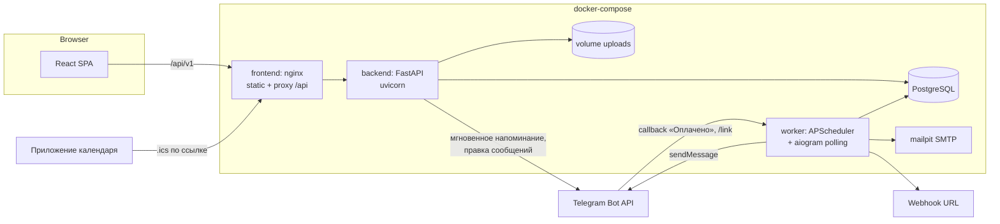
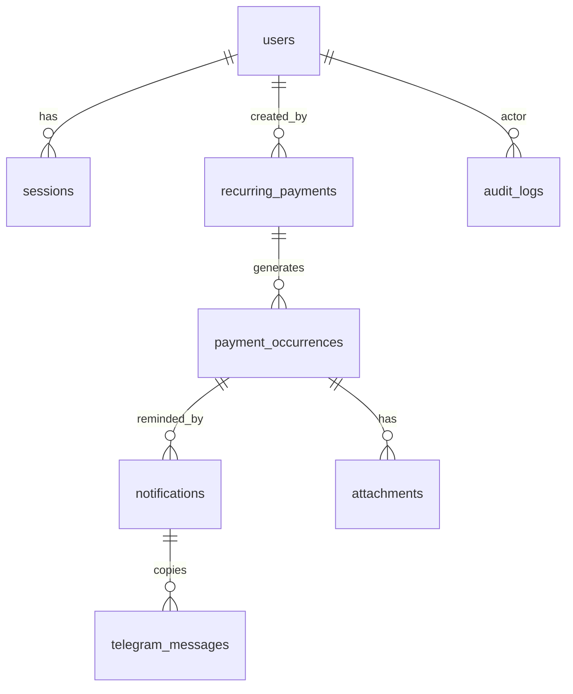

# Архитектура Invoice Keeper

Напоминания о регулярных платежах. Документ описывает, как устроено решение: требования, стек,
компоненты, модель данных, бизнес-правила, API, каналы уведомлений и принятые решения.

---

## 0. Требования

### 0.1 Суть
Система, которая не даёт забыть о регулярных платежах (аренда, подписки, серверы).
- **Администратор** вносит регулярные платежи и управляет пользователями.
- **Система** минимум за 3 дня до срока пишет в Telegram-чат.
- **Пользователи** видят общий список, отмечают оплату, следят за просрочками.
- Ответ системы: *что и когда оплатить, что уже оплачено, что просрочено.*

### 0.2 Ключевые параметры
| Параметр | Значение |
|---|---|
| Напоминание | ≥ 3 дня до срока, в Telegram-чат |
| Роли | администратор (из `.env`) и пользователь |
| Валюты | RUB, USD, EUR; итоги **отдельно по каждой валюте**, без конвертации и курсов |
| Периодичность | еженедельно, ежемесячно, ежеквартально, ежегодно |
| Часовой пояс | единый, задаётся в `.env` (`APP_TIMEZONE`) |
| Нет числа в месяце | последний день месяца (31 → 28/29/30) |

### 0.3 Бизнес-правила
1. **Регулярный платёж** — повторяющийся расход; у **каждого периода** своя дата оплаты и своя отметка «Оплачено / Не оплачено».
2. **Оплачено** — оплата подтверждена и указана **фактическая дата**.
3. **Не оплачено** — оплата не подтверждена; **при отмене отметки фактическая дата очищается**.
4. **Просрочка** — со **следующего дня** после срока. Оплата **в день срока — вовремя**.
5. Исправили фактическую дату → просрочка **пересчитывается**, срок **не меняется**.
6. Новый период **не стирает** прошлые оплаты; просрочка **не останавливает** следующие периоды.
7. Отметка оплаты — только для **конкретного периода**. История оплат сохраняется.
8. Напоминание: название, сумма, валюта, дата. **Без дублей.** Оплаченный период — без напоминания.
9. Платёж добавлен позже, чем за 3 дня до срока → напоминание **сразу**.
10. **Удалённый** регулярный платёж больше не создаёт напоминаний (история сохраняется).
11. Администратор задаётся через `.env`; его учётную запись **через панель и API не изменить**.
12. Ограничения прав действуют **и в веб-панели, и в API**.
13. Без авторизации панель и данные недоступны.
14. Всё сохраняется после перезапуска.

### 0.4 Матрица прав
| Действие | Пользователь | Администратор |
|---|:-:|:-:|
| Вход / выход / `me` | ✅ | ✅ |
| Смотреть регулярные платежи и периоды, итоги, календарь | ✅ | ✅ |
| Отметить / отменить оплату, указать / исправить фактическую дату | ✅ | ✅ |
| Прикрепить чек / ссылку к оплате | ✅ | ✅ |
| Создать / удалить (прекратить) регулярный платёж | ❌ 403 | ✅ |
| Создать / изменить / удалить обычного пользователя | ❌ 403 | ✅ |
| Изменить / удалить администратора из `.env` | ❌ | ❌ 403 |
| Журнал действий и уведомлений, изменение бюджетов | ❌ 403 | ✅ |

### 0.5 Дополнительные возможности
Реализованы все девять из кейса:
| Возможность | Как сделано |
|---|---|
| Кнопка «Оплачено» в Telegram | §6: отмечает период от имени привязанного пользователя, обновляет все копии сообщения |
| Календарь оплат | страница «Календарь» + подписка на календарь в формате iCalendar (§5.2) |
| Итоги на дату по валютам | `GET /payments/summary?as_of=…` (§4.7) |
| Бюджет на месяц и год | `GET/PUT /budgets`, остаток бюджета в итогах |
| Email-оповещения | SMTP (§7) |
| Webhook | POST с подписью HMAC-SHA256 (§7) |
| Другие каналы | уведомления в веб-панели — колокольчик со счётчиком непрочитанных (§7) |
| Чек или ссылка | вложения к конкретному периоду: файл (pdf/png/jpg/webp, до 10 МБ) или ссылка |
| Логи | журнал входов и действий с фильтрами; журнал отправленных уведомлений |
| Проработанный UX/UI | адаптивная панель, тёмная тема, пустые состояния, подтверждения опасных действий |

---

## 1. Стек технологий

| Слой | Технология | Почему |
|---|---|---|
| Backend API | **Python 3.12, FastAPI** | OpenAPI и Swagger из коробки, валидация Pydantic |
| ORM / миграции | **SQLAlchemy 2.0 (async) + asyncpg, Alembic** | типизированные модели, версионируемая схема |
| БД | **PostgreSQL 16** | транзакции, `ON CONFLICT`, блокировки строк, персистентность |
| Пароли | **argon2** (`pwdlib[argon2]`) | современный хеш |
| Сессии | непрозрачный токен в таблице `sessions`; HttpOnly-cookie **и** `Authorization: Bearer` | настоящий выход (отзыв сессии); cookie для панели, Bearer для Swagger и API-клиентов |
| Telegram-бот | **aiogram 3** (long polling) | отправка сообщений, inline-кнопка «Оплачено», команда `/link` |
| Планировщик | **APScheduler 3** в отдельном процессе `worker` | один исполнитель фоновых задач независимо от числа процессов API |
| Email | `aiosmtplib`; локально — **Mailpit** (SMTP-ловушка с веб-интерфейсом) | проверка писем без внешнего сервера |
| Webhook | `httpx` + подпись HMAC-SHA256 | |
| Frontend | **React 18 + Vite + TypeScript** | |
| UI-кит | **Mantine 7** (+ `@mantine/dates`, `@mantine/notifications`) | таблицы, формы, календарь, тёмная тема |
| Данные на фронте | **TanStack Query 5**, React Router 6, react-hook-form + zod | кеш и инвалидация, формы с валидацией |
| Имитация API | **MSW 2** (`frontend/src/mocks`) | панель работает и разрабатывается без бэкенда |
| Тесты | pytest + pytest-asyncio + httpx, `time-machine`, PostgreSQL; Vitest; Playwright (e2e) | |
| Линт | ruff, mypy (strict); eslint + tsc | |
| Запуск | **Docker Compose**: `db`, `backend`, `worker`, `frontend` (nginx), `mailpit` | запуск одной командой |

---

## 2. Архитектура

### 2.1 Компоненты и процессы



- **backend** — HTTP API, бизнес-правила, авторизация, Swagger. При старте: `alembic upgrade head` → синхронизация администратора из `.env` → тестовые данные (если `SEED_DEMO_DATA=true`).
- **worker** — один процесс: планировщик (создание периодов, напоминания, повторы после ошибок, очистка сессий) и Telegram-бот (кнопка «Оплачено», `/link`). Использует **те же сервисы**, что и API (общий пакет `app`).
- **Мгновенное напоминание** (правило 9): после создания платежа API сам запускает рассылку в `BackgroundTasks`. После отметки оплаты в панели API в фоне правит сообщения в Telegram. Дубли исключены уникальным ключом в `notifications` (§4.5), поэтому одновременная работа worker и API безопасна.
- **На сервере** перед стеком стоит edge-nginx с HTTPS (Let's Encrypt), ограничением частоты запросов и попыток входа с одного IP — см. [`docs/deploy-vps.md`](docs/deploy-vps.md).

### 2.2 Слои backend

```
api (роутеры, схемы Pydantic, зависимости авторизации)  ← зависит от ↓
services (сценарии: платежи, периоды, напоминания, итоги, пользователи, журнал, каналы)
domain (чистые функции и enum: расчёт дат, статус и просрочка)  ← без зависимостей
models (SQLAlchemy), bot (aiogram), notifiers (telegram / email / webhook / inapp)
```
Правила: `domain` не импортирует ничего из FastAPI и SQLAlchemy; роутеры не содержат бизнес-логики; права проверяются зависимостями `get_current_user` / `require_admin` на уровне API **и** повторно в сервисах для критичных операций (защита администратора из `.env`).

### 2.3 Структура репозитория
```
.
├── README.md
├── ARCHITECTURE.md
├── .env.example              # все переменные, без секретов
├── docker-compose.yml        # локальный запуск
├── docker-compose.prod.yml   # дополнение для сервера (HTTPS, edge-nginx)
├── deploy/nginx/             # edge-nginx: HTTPS, ограничение частоты запросов
├── docs/
│   ├── openapi.yaml          # спецификация API
│   └── deploy-vps.md         # развёртывание на сервере
├── backend/
│   ├── Dockerfile, pyproject.toml, alembic.ini
│   ├── alembic/versions/     # миграции
│   ├── entrypoint.sh         # миграции → администратор → тестовые данные → uvicorn
│   ├── app/
│   │   ├── main.py           # FastAPI, Swagger на /api/v1/docs
│   │   ├── config.py         # pydantic-settings, проверка .env
│   │   ├── domain/           # schedule.py (сроки), status.py (просрочка), enums.py
│   │   ├── models/           # SQLAlchemy-модели
│   │   ├── schemas/          # схемы запросов и ответов
│   │   ├── services/         # бизнес-логика; notifiers/ — каналы уведомлений; ical.py — календарь
│   │   ├── api/v1/           # HTTP-эндпоинты
│   │   ├── bot/              # aiogram: обработчики, защита от флуда
│   │   ├── worker.py         # планировщик + бот
│   │   ├── bootstrap.py      # администратор из .env
│   │   ├── seed.py           # тестовые данные
│   │   └── scripts/export_openapi.py
│   └── tests/                # unit, integration, api, contract
├── frontend/
│   ├── Dockerfile            # сборка → nginx :8080
│   ├── nginx.conf            # SPA + proxy /api/ → backend:8000
│   └── src/
│       ├── api/              # контракт: client.ts, hooks.ts, types.ts
│       ├── auth/             # AuthProvider, RequireAuth, RequireAdmin
│       ├── lib/              # даты, форматирование, тексты журнала
│       ├── mocks/            # имитация API (MSW) с теми же правилами
│       ├── pages/, components/, styles/
│       └── App.tsx, main.tsx
└── e2e/                      # сквозные тесты Playwright
```

---

## 3. Модель данных



### 3.1 Таблицы
**users**
| поле | тип | примечание |
|---|---|---|
| id | uuid PK | |
| login | varchar(64), уникальный индекс по `lower(login)` | без учёта регистра |
| password_hash | text | argon2 |
| full_name | varchar(128) null | |
| email | varchar(255) null | для email-оповещений |
| role | enum `admin`/`user` | |
| is_system | bool | `true` только у администратора из `.env` → неизменяем через API |
| telegram_user_id | bigint null unique | привязка для кнопки «Оплачено» и личных сообщений |
| notify_email | bool | |
| calendar_token | varchar(64) null unique | секрет ссылки подписки на календарь |
| created_at, updated_at | timestamptz | |

**sessions** — `id`, `token_hash` (sha256 от токена, unique), `user_id` FK on delete cascade, `created_at`, `expires_at`, `last_seen_at`, `user_agent`, `ip`.

**recurring_payments**
| поле | тип | примечание |
|---|---|---|
| id | uuid PK | |
| name | varchar(200) | |
| description | text null | |
| amount | numeric(14,2) > 0 | никаких float |
| currency | enum `RUB`/`USD`/`EUR` | |
| period | enum `weekly`/`monthly`/`quarterly`/`yearly` | |
| first_due_date | date | **якорь**: из него берётся день месяца |
| end_date | date null | «до даты» |
| is_active | bool | |
| deleted_at | timestamptz null | мягкое удаление = прекращение |
| created_by | FK users | |
| created_at | timestamptz | |

**payment_occurrences** (период)
| поле | тип | примечание |
|---|---|---|
| id | uuid PK | |
| recurring_payment_id | FK | |
| seq | int | номер периода n (0, 1, 2…) |
| due_date | date | **никогда не меняется** через API |
| amount, currency | копия | на момент создания периода — история не «плывёт» |
| status | enum `unpaid`/`paid` | |
| paid_date | date null | фактическая дата; `NULL` ⇔ `unpaid` (CHECK) |
| paid_by | FK users null | |
| paid_marked_at | timestamptz null | |
| note | text null | |
| UNIQUE(recurring_payment_id, seq) | | защита от дублей периодов |
| CHECK((status='paid') = (paid_date IS NOT NULL)) | | инвариант правил 2–3 |

Индексы: `(due_date)`, `(status, due_date)`, `(recurring_payment_id, due_date)`.

**notifications** (журнал и идемпотентность напоминаний)
`id`, `occurrence_id` FK, `channel` enum `telegram/email/webhook/inapp`, `kind` enum `before_due/overdue`, `status` enum `pending/sent/failed`, `attempts`, `last_error`, `claimed_at`, `sent_at`, `telegram_message_id`, `created_at`.
**UNIQUE(occurrence_id, channel, kind)** — ядро правила «без дублей».

**telegram_messages** — все копии одного напоминания: в общем чате и в личках тех, кого в чате нет. `notification_id` FK, `chat_id`, `message_id`, `user_id` null (null — общий чат); UNIQUE(notification_id, chat_id). Нужны, чтобы после оплаты заменить каждую копию на «оплачено».

**attachments** — `id`, `occurrence_id` FK, `kind` `file/link`, `url` null, `file_path` null, `original_name`, `content_type`, `size`, `uploaded_by`, `created_at`.

**audit_logs** — `id`, `at`, `actor_id` null, `actor_login`, `action` (`auth.login`, `auth.login_failed`, `auth.logout`, `payment.create`, `payment.delete`, `occurrence.mark_paid`, `occurrence.mark_unpaid`, `occurrence.change_paid_date`, `user.create/update/delete`, `attachment.add/delete`, `telegram.mark_paid`), `entity_type`, `entity_id`, `details` jsonb, `ip`.

**notification_reads** — `user_id` FK, `notification_id` FK, `read_at`; PK(user_id, notification_id). Отметки «прочитано» для канала `inapp`: уведомление одно на период (общая лента), прочитанность — у каждого пользователя своя.

**budgets** — `id`, `currency`, `period_type` `month/year`, `year`, `month` null, `amount`; UNIQUE(currency, period_type, year, month).

**telegram_link_codes** — `code` (6 цифр), `user_id`, `expires_at` (10 минут), `used_at`.

### 3.2 Миграции
Alembic, применяются автоматически при старте `backend`:
`0001` — стартовая схема со всеми таблицами и ограничениями; `0002` — `notifications.claimed_at`; `0003` — `telegram_messages`; `0004` — `users.calendar_token`.

---

## 4. Ключевая доменная логика

### 4.1 Расчёт дат периодов — `domain/schedule.py`
Даты всегда считаются **от якоря**, а не от предыдущей даты (иначе 31.01 → 28.02 → 28.03 — ошибка).
```python
def due_date(first_due: date, period: Period, n: int) -> date:
    if period is Period.WEEKLY:
        return first_due + timedelta(weeks=n)
    months = {MONTHLY: 1, QUARTERLY: 3, YEARLY: 12}[period] * n
    y, m = divmod(first_due.month - 1 + months, 12)
    year, month = first_due.year + y, m + 1
    day = min(first_due.day, calendar.monthrange(year, month)[1])  # нет числа → последний день
    return date(year, month, day)
```
Покрыто unit-тестами: 31.01 → 28.02 (29.02 в високосный) → 31.03 → 30.04; 30.01 → 28.02 → 30.03; 29.02 (ежегодно) → 28.02 следующего года → 29.02 через 4 года; еженедельно и ежеквартально.

`dates_in_range(payment, from, to)` — плановые сроки для календаря и итогов будущих месяцев без создания периодов.

### 4.2 Создание периодов — `services/occurrences.py`
- **Горизонт**: для каждого активного платежа в БД существуют все периоды с `due_date <= today + OCCURRENCE_HORIZON_DAYS` (по умолчанию 60) **и всегда минимум один будущий** (`due_date > today`) — следующий период с отдельным статусом виден сразу.
- `ensure_occurrences` идемпотентна: досоздаёт недостающие периоды через `INSERT … ON CONFLICT (recurring_payment_id, seq) DO NOTHING`.
- Вызывается при создании платежа (в той же транзакции), worker'ом на каждой проверке и перед чтением списков — пропущенный запуск worker'а ничего не ломает.
- Статус и просрочка прошлых периодов **не влияют** на создание следующих (правило 6). Новые периоды создаются со `status=unpaid`, существующие не трогаются.
- Если `first_due_date` в прошлом — создаются и прошлые периоды (неоплаченные станут просроченными).

### 4.3 Статус и просрочка — `domain/status.py`
`today` = `datetime.now(ZoneInfo(APP_TIMEZONE)).date()` — **единый пояс из `.env`**, системное время контейнера не используется.
```python
def is_overdue(o, today):
    if o.status == PAID:
        return o.paid_date > o.due_date          # оплачено позже срока
    return today > o.due_date                     # со следующего дня после срока

def state(o, today):  # для панели и фильтров
    paid → "paid" | "paid_late"
    unpaid → "overdue" если today > due; "due_soon" если due - today <= REMIND_DAYS; иначе "upcoming"
```
- Оплата в день срока (`paid_date == due_date`) — вовремя.
- Исправление `paid_date` на дату ≤ срока **убирает** просрочку (правило 5) — поле вычисляемое, ничего «залипшего» не хранится.
- `days_overdue` = `(paid_date or today) - due_date` при положительном значении.
- `is_overdue`, `state`, `days_overdue` отдаются в API как вычисляемые; фильтр `overdue=true` — SQL-выражение с тем же смыслом (`(status='unpaid' AND due_date < :today) OR (status='paid' AND paid_date > due_date)`). Тест сверяет SQL-фильтр с Python-функцией.

### 4.4 Изменение оплаты — `PATCH /payment-occurrences/{id}`
Тело: `{ "status": "paid" | "unpaid", "paid_date": "YYYY-MM-DD" | null }` (оба необязательны).
| Запрос | Результат |
|---|---|
| `status=paid`, без даты | `paid_date = today` |
| `status=paid`, `paid_date=X` | `paid_date = X` |
| только `paid_date=X` у оплаченного | исправление фактической даты |
| только `paid_date` у неоплаченного | **409** `not_paid` — «сначала отметьте оплату» |
| `status=paid` у уже оплаченного | **409** `already_paid` — кто и когда уже отметил; дата не перезаписывается молча |
| `status=unpaid` | `paid_date`, `paid_by` очищаются (правило 3) |
| ни `status`, ни `paid_date` | 422 `validation_error` |

Строка периода блокируется (`SELECT … FOR UPDATE`): два одновременных изменения одного периода выполняются по очереди, двойной оплаты не бывает. `paid_date` в будущем → 422. `due_date`, `amount`, `currency` в PATCH **не принимаются**. Каждое изменение пишется в журнал со старым и новым значением. Периоды удалённого платежа остаются доступными для просмотра и исправления истории.

### 4.5 Напоминания — `services/reminders.py`
Отбор кандидатов (SQL):
```
occurrence.status = 'unpaid'
AND payment.deleted_at IS NULL AND payment.is_active
AND occurrence.due_date BETWEEN today AND today + REMIND_DAYS_BEFORE   -- по умолчанию 3
```
Отправка — по каждому включённому каналу (Telegram, панель, а также email и webhook, если настроены):
1. **Захват**: `INSERT INTO notifications(..., status='pending') ON CONFLICT DO NOTHING RETURNING id`. Если запись уже есть — её можно забрать только атомарным `UPDATE`, когда прошлая попытка `failed` и `attempts < 5` или захват «завис» дольше 5 минут (процесс упал). **Это гарантирует «без дублей» даже при одновременной работе worker и API.**
2. Перед отправкой — повторная проверка, что период всё ещё не оплачен и платёж не удалён.
3. Успех → `status='sent'`, `sent_at`. Ошибка → `status='failed'`, `attempts+1`, `last_error`; повтор на следующей проверке.

Запуск:
- worker — сразу при старте и каждые `REMINDER_CHECK_INTERVAL_MINUTES`;
- API — после `POST /recurring-payments`: напоминание **сразу**, если срок ближе 3 дней (правило 9).
- Оплаченный период: отбор по `status='unpaid'` → не напоминаем. Отметили оплату и сняли — напоминание уже `sent`, дубль не создаётся.
- Удалённый платёж: отбор по `deleted_at IS NULL`, будущие неоплаченные периоды удаляются (§4.6).
- `kind='overdue'` — одно сообщение «Просрочено» на следующий день после срока (тот же механизм уникальности).

Формат сообщения в Telegram (HTML, название экранируется):
```
🔔 Напоминание об оплате
<b>Аренда офиса</b>
Сумма: 50 000,00 RUB
Срок оплаты: 25.10.2026 (через 2 дня)
[✅ Оплачено]   [Открыть в панели]
```

### 4.6 Прекращение регулярного платежа — `DELETE /recurring-payments/{id}`
- Мягкое удаление: `deleted_at = now()`, `is_active = false`.
- Периоды с `due_date <= today` или `status='paid'` **сохраняются** (история).
- Будущие неоплаченные периоды удаляются вместе с их неотправленными уведомлениями.
- Создание новых периодов и напоминания прекращаются (фильтр `deleted_at IS NULL`).
- Повторный DELETE → 204 (идемпотентно).
- `GET /recurring-payments` по умолчанию скрывает удалённые; `?include_deleted=true` — показывает.

### 4.7 Итоги по валютам — `GET /payments/summary`
Параметры: `date_from`, `date_to` (по умолчанию — текущий месяц), `as_of` (итоги на дату).
Ответ — **по каждой валюте, всегда все три**, без конвертации:
```json
{ "period": {"from": "2026-10-01", "to": "2026-10-31"}, "as_of": "2026-10-23",
  "totals": [
    {"currency": "RUB", "planned": "50000.00", "paid": "0.00", "unpaid": "50000.00",
     "overdue": "0.00", "paid_late": "0.00", "count_total": 1, "count_paid": 0, "count_overdue": 0,
     "budget": "60000.00", "budget_left": "10000.00"},
    {"currency": "USD", ...}, {"currency": "EUR", ...}] }
```
Суммы — `numeric` в SQL с `GROUP BY currency`. Семантика полей:
- `planned` — сумма периодов в `[date_from, date_to]` плюс плановые сроки без созданных периодов; `count_total` — их количество.
- «Оплачен на дату» = `status='paid' AND paid_date <= as_of` (`as_of` по умолчанию — сегодня).
- `paid` — сумма оплаченных на дату; `unpaid` = `planned − paid`.
- `overdue` — **только неоплаченное** на дату с `due_date < as_of`; `count_overdue` — их число.
- `paid_late` — оплаченное на дату с `paid_date > due_date` (отдельно от `overdue`).
- `budget` — бюджет валюты на месяц (`null`, если не задан); `budget_left = budget − planned`.

### 4.8 Авторизация и администратор из `.env`
- `bootstrap.py` при старте создаёт или обновляет пользователя `ADMIN_LOGIN` с `role=admin, is_system=true`, пароль из `ADMIN_PASSWORD`. Если логин администратора в `.env` сменили — прежний системный администратор теряет права, его сессии удаляются.
- `POST /users` всегда создаёт `role=user` (поля `role` в схеме нет). Создать администратора через API невозможно.
- `PATCH/DELETE /users/{id}` для `is_system=true` → **403** `system_user`.
- `POST /auth/login` → `{access_token, token_type, expires_at, user}` + `Set-Cookie: ik_session=…; HttpOnly; SameSite=Lax`. Токен — `secrets.token_urlsafe(32)`, в БД хранится sha256. Срок `SESSION_TTL_HOURS` (по умолчанию 168), продлевается при работе — вместе с сессией продлевается и cookie.
- Текущий пользователь определяется по cookie **или** `Authorization: Bearer` (кнопка Authorize в Swagger).
- `POST /auth/logout` удаляет сессию и cookie. Удаление пользователя или смена его пароля удаляет все его сессии.
- Неверный логин или пароль → 401 с одинаковым сообщением; после серии неудачных попыток — 429 `rate_limited`; неудачные входы пишутся в журнал.
- Все эндпоинты, кроме входа, `/health`, Swagger, OpenAPI и ссылки календаря (защищена секретным токеном), требуют авторизации. Тест перебирает все маршруты приложения и проверяет 401 без токена.

---

## 5. API

Общее: префикс **`/api/v1`**; ошибки в едином формате `{"detail": "...", "code": "..."}`; деньги — строки с 2 знаками; даты — `YYYY-MM-DD`; списки — `{items, total, limit, offset}`.
Полная спецификация — [`docs/openapi.yaml`](docs/openapi.yaml), Swagger — `/api/v1/docs`.

### 5.1 Обязательные эндпоинты
| Метод | Путь | Назначение | Роль |
|---|---|---|---|
| POST | `/api/v1/auth/login` | вход по логину и паролю | все |
| GET | `/api/v1/auth/me` | текущий пользователь | auth |
| POST | `/api/v1/auth/logout` | завершение текущей сессии | auth |
| GET | `/api/v1/recurring-payments` | список регулярных платежей (`include_deleted`, `currency`, `q`) + ближайший период | auth |
| POST | `/api/v1/recurring-payments` | создание регулярного платежа | admin |
| DELETE | `/api/v1/recurring-payments/{id}` | прекращение платежа и напоминаний с сохранением истории | admin |
| GET | `/api/v1/payment-occurrences` | список периодов: фильтры `status`, `overdue`, `state`, `date_from`, `date_to`, `currency`, `recurring_payment_id`, сортировка, пагинация | auth |
| GET | `/api/v1/payment-occurrences/{id}` | конкретный период | auth |
| PATCH | `/api/v1/payment-occurrences/{id}` | подтверждение или отмена оплаты, исправление фактической даты | auth |
| GET | `/api/v1/payments/summary` | итоговые суммы по валютам | auth |
| GET | `/api/v1/users` | список пользователей | admin |
| POST | `/api/v1/users` | создание обычного пользователя | admin |
| PATCH | `/api/v1/users/{id}` | изменение пользователя (логин, ФИО, email, пароль) | admin |
| DELETE | `/api/v1/users/{id}` | удаление пользователя | admin |
| GET | `/api/v1/docs` | Swagger UI | публично |
| GET | `/api/v1/openapi.json` | OpenAPI JSON | публично |

`POST /recurring-payments`: `{name, description?, amount: "50000.00", currency, period: "monthly", next_due_date, end_date?}`. `next_due_date` — «дата ближайшей оплаты» из кейса; в БД сохраняется как якорь `first_due_date`. Ответ 201: платёж + `next_occurrence`. Валидация: `amount > 0`, не больше 2 знаков, `currency ∈ {RUB, USD, EUR}`, `name` 1–200 символов, `end_date >= next_due_date`.

### 5.2 Дополнительные эндпоинты
| Метод | Путь | Назначение | Роль |
|---|---|---|---|
| PATCH | `/api/v1/auth/me` | своя почта и email-оповещения | auth |
| GET | `/api/v1/recurring-payments/{id}` | регулярный платёж со всеми периодами | auth |
| GET | `/api/v1/payments/calendar?month=YYYY-MM` | периоды по дням + будущие плановые сроки | auth |
| POST / DELETE | `/api/v1/calendar/subscription` | получить / отключить ссылку подписки на календарь | auth |
| GET | `/api/v1/calendar/{token}.ics` | сроки в формате iCalendar для приложения календаря | по секретной ссылке |
| GET / PUT | `/api/v1/budgets` | бюджеты по валютам на месяц и год | GET auth / PUT admin |
| GET / POST | `/api/v1/payment-occurrences/{id}/attachments` | чеки и ссылки периода; файл multipart или JSON `{url}` | auth |
| GET | `/api/v1/attachments/{id}/download` | скачивание файла | auth |
| DELETE | `/api/v1/attachments/{id}` | удаление (автор или администратор) | auth |
| GET | `/api/v1/audit-logs` | журнал входов и действий с фильтрами | admin |
| GET | `/api/v1/notifications` | журнал отправленных уведомлений (канал, статус, ошибка) | admin |
| POST | `/api/v1/notifications/test` | тестовое сообщение во все каналы | admin |
| GET | `/api/v1/inbox` | уведомления в панели + `unread_count` | auth |
| POST | `/api/v1/inbox/{id}/read`, `/api/v1/inbox/read-all` | отметить прочитанным | auth |
| POST | `/api/v1/telegram/link-code` | код привязки Telegram | auth |
| GET | `/api/v1/health` | состояние сервиса и БД | публично |

### 5.3 OpenAPI-спецификация
- FastAPI: `docs_url="/api/v1/docs"`, `openapi_url="/api/v1/openapi.json"`; теги, описания, примеры и коды ответов 401/403/404/409/422.
- `python -m app.scripts.export_openapi > docs/openapi.yaml`. Файл в репозитории.
- Тест сравнивает сгенерированную схему с `docs/openapi.yaml` — спецификация не может устареть.

### 5.4 Контракт веб-панели
Веб-панель и её имитация API (`frontend/src/mocks`) описывают ожидаемые ответы в `frontend/src/api/types.ts`. Бэкенд реализует ровно этот контракт; контрактные тесты (`backend/tests/contract`) сверяют ответы API с `types.ts`.

**Формы ответов:**
- `GET /auth/me` → `{ user, server_today, timezone }`; `server_today` считается в `APP_TIMEZONE`, фронтенд берёт «сегодня» только отсюда.
- `User` = `{id, login, full_name, email, role, is_system, telegram_linked, notify_email, created_at}` — id в Telegram наружу не отдаётся.
- `Occurrence` дополнительно к полям §3.1: `recurring_payment: {id, name, period, is_deleted}`, `paid_by: {id, login, full_name} | null`, вычисляемые `is_overdue`, `state`, `days_overdue`, а также `attachments_count` и `last_reminder_at`.
- `GET /payment-occurrences/{id}` → `Occurrence` + `history` (записи журнала по периоду) + `reminders` (все уведомления по периоду).
- `RecurringPayment` = поля §3.1 + `created_by` + `next_occurrence`; `GET /recurring-payments/{id}` → + `occurrences[]`. Список: сначала активные, затем прекращённые; внутри — по ближайшему сроку.
- `GET /payment-occurrences`: `currency` повторяется (`currency=RUB&currency=USD`); `sort` ∈ `due_date | -due_date | amount | -amount | days_overdue | -days_overdue`.
- `GET /payments/calendar` → `{ month, days: [{ date, occurrences, planned }] }`; `planned` — будущие сроки без созданных периодов.
- `GET /inbox` → `{ items, unread_count }`; `POST /notifications/test` → `{ channels: [{channel, ok, error}] }`; `POST /telegram/link-code` → `{code, expires_at}`.

**Ошибки:** всегда `{detail, code}`, `detail` — по-русски, готов к показу пользователю. Ошибки валидации Pydantic переводятся в `422 validation_error` с понятными текстами. Коды, которые различает панель: `unauthorized`, `invalid_credentials` (401), `rate_limited` (429), `forbidden`, `system_user` (403), `not_found` (404), `login_taken`, `not_paid`, `already_paid` (409), `validation_error` (422).

**Валидация:** логин `^[a-z0-9._-]{3,64}$` (без учёта регистра, уникален), пароль ≥ 8 символов, email — простой формат.

---

## 6. Telegram-бот

- Настройки: `TELEGRAM_BOT_TOKEN`, `TELEGRAM_CHAT_ID` (группа, канал или личный чат), `TELEGRAM_ENABLED`.
- **Кто получает напоминание.** Сообщение уходит в общий чат. Пользователям, которые привязали Telegram, но не состоят в чате (проверка `getChatMember`), бот пишет в личку. Все копии запоминаются в `telegram_messages`.
- Кнопки: `✅ Оплачено` (`callback_data="pay:<occurrence_id>"`) и `Открыть в панели` (ссылка на `PUBLIC_WEB_URL/occurrences/<id>`; кнопка не добавляется, если адрес — localhost: Telegram такие ссылки не принимает).
- **Кнопка «Оплачено»** — обработчик в worker:
  1. Ищет пользователя по `telegram_user_id`. Не привязан → подсказка «Привяжите аккаунт» во всплывающем окне.
  2. Отмечает период тем же сервисом, что и API (права, правила и блокировка строки — общие).
  3. Заменяет **все копии** сообщения — в чате и в личках — на «✅ Оплачено: кто, когда» без кнопки. Повторное нажатие → «Уже оплачено».
  4. Пишет `telegram.mark_paid` в журнал.
- Оплата или отмена оплаты в панели тоже обновляет все копии: оплачено → «оплачено», отметку сняли → снова напоминание с кнопкой.
- **Привязка аккаунта:** «Профиль» → «Получить код» → `POST /telegram/link-code` → в личке с ботом `/link 123456` → `telegram_user_id` сохраняется. `/start` выдаёт инструкцию.
- **Защита от флуда:** не больше 10 событий от одного человека за 10 секунд, лишние отбрасываются без запросов к БД. Входящих портов у бота нет (long polling).
- Токен бота не попадает в логи: адреса запросов к Bot API маскируются.
- Без токена система запускается и работает: напоминания помечаются `failed` с понятной причиной в журнале уведомлений, при появлении токена ближайшая проверка их отправит.

## 7. Email, Webhook и уведомления в панели
- **Email**: `SMTP_HOST/PORT/USER/PASSWORD/FROM/TLS`, `EMAIL_ENABLED`. Получатели — пользователи с `email` и `notify_email=true`, плюс `EMAIL_EXTRA_RECIPIENTS`. Одно письмо на период — уникальность по `(occurrence_id, 'email', kind)`. Локально письма попадают в Mailpit (`http://localhost:8025`).
- **Webhook**: `WEBHOOK_URL`, `WEBHOOK_SECRET`. `POST` JSON `{event: "payment.reminder", occurrence: {...}, payment: {...}}`, заголовок `X-InvoiceKeeper-Signature: sha256=<hmac>`, таймаут 5 с, повторы по общей схеме `notifications`.
- **Уведомления в веб-панели** (канал `inapp`) — работают без внешних сервисов и настроек.
  - «Отправка» — запись в `notifications` со `status='sent'` (тот же уникальный ключ → без дублей). Типы: `before_due`, `overdue`.
  - Лента общая для всех пользователей, прочитанность — у каждого своя (`notification_reads`).
  - Если период оплачен или платёж прекращён, уведомление остаётся в ленте с актуальным статусом.
- Все каналы реализуют один интерфейс `Notifier`; сбой одного канала не мешает остальным — у каждого своя запись в журнале.
- **Календарь (iCalendar, RFC 5545)**: личная ссылка `/api/v1/calendar/<token>.ics` отдаёт сроки неоплаченных и оплаченных периодов. Приложение календаря перечитывает её само, поэтому оплата и новые периоды появляются без действий пользователя. У событий постоянный UID, текст экранируется, длинные строки переносятся по 75 байт. Ссылку можно отключить — старая перестаёт работать.

---

## 8. Фоновые задачи (worker)
| Задача | Расписание | Что делает |
|---|---|---|
| напоминания | при старте + каждые `REMINDER_CHECK_INTERVAL_MINUTES` | досоздаёт периоды (§4.2), рассылает напоминания и сообщения о просрочке по всем каналам (§4.5), повторяет неудачные отправки |
| очистка | ежедневно в 03:00 | удаляет истёкшие сессии и коды привязки Telegram |

Задачи не запускаются параллельно сами с собой (`max_instances=1`), у каждой своя сессия БД; ошибка пишется в лог и не останавливает планировщик. В тестах задачи вызываются напрямую с замороженным временем.

---

## 9. Веб-панель

### 9.1 Страницы
| Путь | Страница | Роль | Содержимое |
|---|---|---|---|
| `/login` | Вход | все | логин и пароль, ошибки |
| `/` | Сводка | auth | итоги по трём валютам (план, оплачено, осталось, просрочено, бюджет); блоки «Просрочено» и «Ближайшие»; быстрая отметка оплаты |
| `/occurrences` | Платежи (периоды) | auth | название, сумма, валюта, срок, статус, фактическая дата, просрочка; фильтры, сортировка, пагинация; «Отметить оплату», «Отменить оплату», «Изменить дату», вложения |
| `/occurrences/:id` | Период | auth | детали, история изменений, напоминания, чеки и ссылки |
| `/recurring-payments` | Регулярные платежи | auth (создание и прекращение — admin) | список с ближайшим сроком; добавление; прекращение с подтверждением; «показать прекращённые» |
| `/recurring-payments/:id` | Платёж | auth | параметры и все периоды |
| `/calendar` | Календарь | auth | месячная сетка: статусы и суммы по валютам за день |
| `/summary` | Итоги | auth | период и дата `as_of`, итоги по валютам, бюджеты (admin редактирует), плановые расходы |
| `/users` | Пользователи | admin | создание, изменение, удаление; администратор из `.env` помечен, действия с ним недоступны |
| `/audit` | Журнал | admin | входы и действия с фильтрами; вкладка «Уведомления» и тестовая отправка |
| `/settings` | Профиль | auth | привязка Telegram, email-оповещения, ссылка на календарь |

В шапке каждой страницы — **колокольчик** со счётчиком непрочитанных: последние уведомления, переход к периоду, «Прочитать все».

### 9.2 Поведение
- `AuthProvider` при загрузке запрашивает `GET /auth/me`; 401 на любом запросе → сброс кеша и переход на `/login?next=…`. Маршруты обёрнуты `RequireAuth` / `RequireAdmin`; элементы администратора скрыты от пользователя, но защита — на сервере.
- Запросы — `fetch` с cookie; единый обработчик ошибок показывает `detail`.
- После изменений инвалидируются связанные запросы (периоды, итоги, календарь, платежи); выход и вход синхронизируются между вкладками браузера.
- Суммы — `Intl.NumberFormat('ru-RU')`, даты — `дд.мм.гггг`; «сегодня» берётся с сервера, поэтому панель и API одинаково понимают просрочку.
- Статусы: «Оплачено», «Оплачено с опозданием», «Скоро» (≤ 3 дней), «Просрочено N дн.», «Ожидает».
- Адаптивная вёрстка, тёмная тема, пустые состояния, скелетоны загрузки, подтверждения опасных действий, русский интерфейс.
- Слои фронтенда разделены: контракт (`src/api`, `src/auth`, `src/lib`, `src/mocks`) и оформление (`src/pages`, `src/components`, `src/styles`). Страницы получают данные только через хуки `src/api/hooks.ts`.
- Режим имитации (`npm run dev`, `VITE_API_MOCK=true`) повторяет правила бэкенда в браузере — панель можно разрабатывать без сервера (см. `frontend/README.md`).

---

## 10. Конфигурация (`.env.example`)
```dotenv
# --- App ---
APP_TIMEZONE=Europe/Moscow
PUBLIC_WEB_URL=http://localhost:8080
REMIND_DAYS_BEFORE=3
REMINDER_CHECK_INTERVAL_MINUTES=1
OCCURRENCE_HORIZON_DAYS=60
SESSION_TTL_HOURS=168
SEED_DEMO_DATA=true
LOG_LEVEL=INFO

# --- Admin (единственный способ задать администратора) ---
ADMIN_LOGIN=admin
ADMIN_PASSWORD=change-me

# --- Database ---
POSTGRES_DB=invoice_keeper
POSTGRES_USER=invoice_keeper
POSTGRES_PASSWORD=change-me
DATABASE_URL=postgresql+asyncpg://invoice_keeper:change-me@db:5432/invoice_keeper

# --- Telegram ---
TELEGRAM_ENABLED=true
TELEGRAM_BOT_TOKEN=
TELEGRAM_CHAT_ID=

# --- Email (по умолчанию — Mailpit из docker-compose) ---
EMAIL_ENABLED=true
SMTP_HOST=mailpit
SMTP_PORT=1025
SMTP_USER=
SMTP_PASSWORD=
SMTP_FROM=invoice-keeper@example.local
SMTP_TLS=false
EMAIL_EXTRA_RECIPIENTS=

# --- Уведомления в веб-панели ---
INAPP_ENABLED=true

# --- Webhook ---
WEBHOOK_URL=
WEBHOOK_SECRET=

# --- Uploads ---
UPLOAD_DIR=/data/uploads
UPLOAD_MAX_MB=10
```
`config.py` (pydantic-settings) проверяет значения при старте: часовой пояс существует, `REMIND_DAYS_BEFORE >= 3`, пароль администратора не короче 8 символов. `.env` не попадает в репозиторий.

## 11. Docker Compose
- `db`: `postgres:16-alpine`, том `pgdata`, healthcheck `pg_isready`.
- `backend`: образ из `./backend`, ждёт готовности `db`; при старте — миграции, администратор, тестовые данные, затем uvicorn; том `uploads`; healthcheck `/api/v1/health`.
- `worker`: тот же образ, `python -m app.worker`, ждёт готовности `backend` (миграции уже применены).
- `frontend`: сборка node → nginx, порт **8080**, `/api/` проксируется в `backend:8000`, остальное — SPA.
- `mailpit`: веб-интерфейс на `8025`.
- Все сервисы `restart: unless-stopped`. Данные — в именованных томах `pgdata` и `uploads`, поэтому переживают перезапуск.
- `docker-compose.prod.yml` для сервера добавляет edge-nginx на 80/443 с сертификатом Let's Encrypt и закрывает внутренние порты.

## 12. Тестовые данные (`seed.py`)
Создаются один раз при первом запуске; даты считаются от текущего дня, поэтому данные одинаково показательны в любой день. 13 регулярных платежей хостинг-провайдера (ЦОД, каналы связи, колокация, лицензии, офис) в трёх валютах, например:
| Что | Сумма | Период | Первая дата | Что показывает |
|---|---|---|---|---|
| Аренда офиса, Санкт-Петербург | 290 000.00 **RUB** | ежемесячно | сегодня + 2 дня | напоминание уходит сразу после запуска |
| IP-транзит, канал 10 Гбит/с | 2 400.00 **USD** | ежемесячно | сегодня − 10 дней | прошлый период оплачен вовремя, текущий просрочен |
| Аренда стойки, Амстердам | 3 100.00 **EUR** | ежемесячно | 31-е число прошлого месяца | «нет числа → последний день»; оплачено с опозданием |
| Домены aeza.ru и aeza.net | 2 900.00 RUB | ежегодно | сегодня + 20 дней | другая периодичность |

Пользователи — те же, что в имитации API панели: `anna`, `maria`, `user`; администратор — из `.env`. Бюджеты: RUB 1 100 000/мес, USD 6 000/мес, EUR 7 000/мес. Почта тестовых пользователей — в несуществующей зоне `.test`. `SEED_DEMO_DATA=false` — пустая система.

---

## 13. Требования → реализация → проверка
| Требование кейса | Где реализовано | Чем проверяется |
|---|---|---|
| Напоминание ≥ 3 дня в Telegram | §4.5, `services/reminders.py`, worker | `tests/integration/test_reminders.py` |
| Без дублей | UNIQUE в `notifications`, `ON CONFLICT`, атомарный повторный захват | тест повторной и параллельной проверки |
| Оплаченный — без напоминания | фильтр `status='unpaid'` + перепроверка перед отправкой | `test_reminders.py` |
| Добавлен позже чем за 3 дня → сразу | `BackgroundTasks` в `POST /recurring-payments` | `test_reminders.py` |
| Удалённый не напоминает, история сохраняется | §4.6 | `tests/api/test_payments.py`, `test_reminders.py` |
| Каждый период — свой статус и дата; прошлые сохраняются | `payment_occurrences`, §4.2 | `test_payments.py` |
| Просрочка со следующего дня; в день срока — вовремя | `domain/status.py` | `tests/unit/test_status.py` |
| Отмена очищает дату; исправление даты пересчитывает просрочку | §4.4, CHECK-ограничение | `test_status.py`, `test_payments.py` |
| Нет двойной оплаты | `SELECT … FOR UPDATE`, 409 `already_paid` | `tests/integration/test_concurrent_payments.py` |
| Нет числа в месяце → последний день | `domain/schedule.py` | `tests/unit/test_schedule.py` |
| Единый часовой пояс из `.env` | `APP_TIMEZONE`, `today_in()` | `tests/unit/test_config.py`, `test_status.py` |
| Две роли, администратор из `.env` неизменяем | `bootstrap.py`, `is_system` | `test_bootstrap.py`, `tests/api/test_users.py` |
| Права и в панели, и в API | `require_admin` + `RequireAdmin` в панели | тесты 403 в `tests/api` |
| Без авторизации ничего недоступно | общая зависимость роутера v1 | `tests/api/test_auth.py` — перебор всех маршрутов |
| RUB/USD/EUR, итоги отдельно | enum + `GROUP BY currency` | `tests/api/test_summary.py` |
| Сохранность после перезапуска | PostgreSQL + тома Docker | `docker compose down && up -d` |
| Запуск по README, `.env.example`, тестовые данные | README, `seed.py` | `tests/integration/test_seed.py` |
| OpenAPI-файл + Swagger `/api/v1/docs` | §5.3 | `tests/contract/test_openapi_file.py` |
| Панель и API согласованы | §5.4 | `tests/contract/test_frontend_contract.py`, e2e Playwright |

Полный путь через интерфейс — вход администратора, новый платёж, напоминание, оплата пользователем, просрочка, исправление даты, следующий период — проверяется e2e-тестами Playwright (`e2e/tests`).

## 14. Риски и решения
| Риск | Решение |
|---|---|
| Запуск без Telegram-токена | система работает; в журнале уведомлений видна причина; после добавления токена напоминания уходят на ближайшей проверке |
| Telegram недоступен | повторы отправки; параллельные каналы — email, webhook, уведомления в панели |
| Время в контейнере UTC ≠ бизнес-часовой пояс | `APP_TIMEZONE` используется везде |
| Дубли при нескольких процессах | уникальный ключ в БД, а не память процесса |
| Процесс упал посреди отправки | «зависший» захват через 5 минут забирается заново |
| Одновременная оплата одного периода | блокировка строки, второй получает 409 `already_paid` |
| Смена логина администратора в `.env` | `bootstrap` переносит `is_system`, старые сессии удаляются |
| Подбор паролей и флуд | ограничение попыток входа в API и на edge-nginx, защита бота от флуда |
| Утечка токена бота через логи | адреса запросов к Bot API маскируются в логах |

## 15. Решения
- **Стек.** Python/FastAPI + PostgreSQL + aiogram + React/Vite/TS: FastAPI даёт OpenAPI и Swagger из коробки, PostgreSQL — транзакционные гарантии для «без дублей».
- **Периоды хранятся в таблице, а не вычисляются на лету** — у каждого периода собственные статус, фактическая дата, вложения и история. Отклонено: хранить только «последнюю оплату» в платеже (теряется история, нарушается правило 6).
- **Даты считаются от якоря**, а не от предыдущего срока — иначе 31-е «съезжает» на 28-е навсегда.
- **Просрочка вычисляется, а не хранится** — исправление даты автоматически убирает ошибочную просрочку. Оплата позже срока — «оплачено с опозданием» (`is_overdue=true`), поэтому исправление даты даёт видимый эффект.
- **«Без дублей» на уровне БД** (UNIQUE + ON CONFLICT), а не флагом в памяти процесса.
- **Мягкое удаление платежа** + удаление только будущих неоплаченных периодов — история сохраняется, напоминания прекращаются.
- **Серверные сессии** с непрозрачным токеном вместо JWT — выход действительно завершает сессию, удаление пользователя сразу отзывает доступ.
- **Отдельный worker** для планировщика и бота — фоновые задачи не дублируются при нескольких процессах API.
- **Сумма и валюта копируются в период** — итоги прошлых периодов не меняются задним числом.
- **Итоги:** `overdue` — только неоплаченное; оплата после срока идёт в отдельное поле `paid_late`.
- **Регулярный платёж не редактируется** — кейс этого не требует; чтобы изменить условия, администратор прекращает платёж (история сохраняется) и создаёт новый.
- **«Оплачено» в Telegram — только для привязанных пользователей**: в групповом чате могут быть посторонние, а в истории должно быть видно, кто оплатил.
- **Повторная отметка оплаты отклоняется (409)**, а не перезаписывает дату: при одновременной оплате видно, кто уже отметил.
