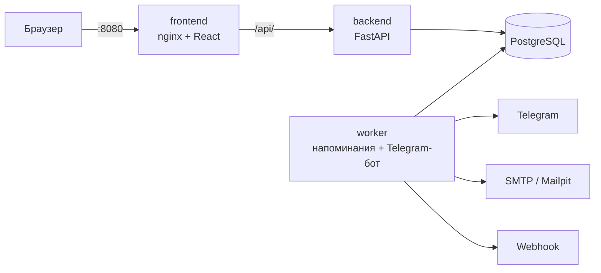

# Invoice Keeper — напоминания о регулярных платежах

Сервис, который не даёт забыть об аренде, подписках и оплате серверов. Администратор вносит регулярные
платежи в рублях, долларах и евро. За 3 дня до срока бот пишет в Telegram-чат команды, а команда отмечает
оплату в веб-панели или кнопкой прямо в сообщении. В любой момент видно, что и когда оплатить, что уже
оплачено и что просрочено.

| | |
|---|---|
| Веб-панель | http://localhost:8080 |
| Swagger | http://localhost:8080/api/v1/docs |
| OpenAPI-спецификация | [`docs/openapi.yaml`](docs/openapi.yaml) |
| Сценарий защиты | [`docs/demo-scenario.md`](docs/demo-scenario.md) |
| Развёртывание на VPS с HTTPS | [`docs/deploy-vps.md`](docs/deploy-vps.md) |
| План, архитектурные решения | [`TASK_PLAN.md`](TASK_PLAN.md) |

**Стек:** Python 3.12, FastAPI, SQLAlchemy 2 (async), PostgreSQL 16, Alembic, APScheduler, aiogram ·
React 18, TypeScript, Vite, Mantine, TanStack Query · Docker Compose.

---

## Быстрый старт

Нужен только **Docker** с Compose v2: Docker Desktop на Windows/macOS или Docker Engine на Linux.

```bash
git clone https://github.com/Rolo909/kefcoders-invoice-keeper.git
cd kefcoders-invoice-keeper
cp .env.example .env
docker compose up --build -d
```

Первая сборка занимает 3–5 минут. Затем откройте **http://localhost:8080** и войдите администратором:
логин `admin`, пароль — `ADMIN_PASSWORD` из `.env` (в `.env.example` это `change-me`).

`docker compose ps` — у `db` и `backend` статус `healthy`, у `worker`, `frontend`, `mailpit` — `running`.

`.env.example` работает без правок. При первом запуске создаются тестовые данные, а письма уходят в
локальный Mailpit (http://localhost:8025). Для Telegram-напоминаний впишите в `.env`
`TELEGRAM_BOT_TOKEN` и `TELEGRAM_CHAT_ID` (как получить — [ниже](#telegram)) и выполните `docker compose up -d`.
Без токена всё остальное работает: в истории периода видна причина, по которой напоминание не ушло,
а как только токен появится, ближайшая проверка его отправит.

| Действие | Команда |
|---|---|
| Остановить | `docker compose down` — данные в Docker-томе сохраняются |
| Начать с чистой базы | `docker compose down -v`, затем `docker compose up -d` |
| Логи напоминаний и бота | `docker compose logs -f worker` |

## Учётные записи

| Логин | Пароль | Роль |
|---|---|---|
| `admin` | `ADMIN_PASSWORD` из `.env` | администратор — задаётся только в `.env`, через панель и API не меняется |
| `anna` | `anna12345` | пользователь |
| `maria` | `maria12345` | пользователь |
| `user` | `user12345` | пользователь |

**Тестовые данные** — 13 регулярных платежей хостинг-провайдера в духе aeza.ru в трёх валютах.
Даты считаются от дня запуска, поэтому сценарий защиты работает в любой день:

| Платёж | Валюта | Что показывает |
|---|---|---|
| Аренда офиса, Санкт-Петербург | RUB | срок через 2 дня — напоминание уходит сразу после запуска |
| Бухгалтерское и налоговое сопровождение | RUB | срок завтра |
| IP-транзит, канал 10 Гбит/с | USD | текущий период просрочен, прошлые оплачены вовремя |
| Аренда стойки, Амстердам | EUR | оплата 31-го числа: в коротких месяцах — последний день; один период оплачен с опозданием |
| Страхование оборудования | RUB | ежеквартальный платёж |
| Домены aeza.ru и aeza.net | RUB | ежегодный платёж |
| Резервный канал связи | RUB | прекращённый платёж: история сохранена, напоминаний нет |

Бюджеты на месяц и год заданы по каждой валюте. Почта тестовых пользователей — в несуществующей зоне `.test`.
Пустая система — `SEED_DEMO_DATA=false` в `.env` и чистая база.

## Сценарий защиты

Полная версия с запросами API к каждому шагу — [`docs/demo-scenario.md`](docs/demo-scenario.md).
Этот же сценарий автоматически проходит в браузере сквозными тестами (`e2e/tests/demo-scenario.spec.ts`).

1. **Войти администратором** (`admin`). «Сводка» показывает остаток к оплате отдельно по RUB, USD и EUR.
2. **Добавить регулярный платёж:** «Новый платёж» → сумма, валюта, периодичность, дата через 2 дня.
3. **Получить напоминание в Telegram:** срок ближе 3 дней, поэтому сообщение приходит сразу. Повторная
   проверка (раз в минуту) дубль не создаёт: «Журнал» → «Уведомления».
4. **Войти пользователем** (`anna`) **и отметить оплату**: «Периоды» → «Отметить оплату». Или кнопкой
   «✅ Оплачено» в Telegram после привязки аккаунта («Профиль» → «Получить код» → боту `/link <код>`).
5. **Показать просроченный платёж:** «IP-транзит» подсвечен, «просрочено на N дней»; фильтр «Просрочено».
6. **Исправить фактическую дату:** «Аренда стойки, Амстердам», «⋯» → «Изменить дату оплаты» → дата срока.
   Просрочка исчезает, срок периода не меняется, в карточке периода — история изменений.
7. **Показать следующий период:** «Платежи» → платёж: у оплаченного периода «Оплачено», у следующего — свой статус.

## Соответствие критериям приёмки

| Критерий кейса | Как сделано | Чем проверено |
|---|---|---|
| Запуск по README; без авторизации панель и данные недоступны | Одна команда `docker compose up`; все маршруты API, кроме входа и `/health`, требуют сессии | тест перебирает **все** маршруты из OpenAPI и ждёт 401; e2e |
| Пользователь не выполнит действия администратора даже через API | Права проверяются на сервере (`require_admin`); в панели кнопки администратора скрыты | тесты 403 на каждый эндпоинт администратора; e2e |
| Следующий период — с отдельным статусом, прошлые сохраняются | Каждый срок — отдельная запись `payment_occurrences` со своим статусом и фактической датой; периоды создаются по расписанию независимо от оплаты прошлых | тесты расписания, e2e шаг 7 |
| Нет числа в месяце → последний день | Срок считается от первой даты платежа, а не от предыдущего срока: 31.01 → 28.02 → 31.03 | модульные тесты `domain/schedule.py` |
| Просрочка — со следующего дня, оплата в день срока вовремя | Просрочка не хранится, а вычисляется из срока и фактической даты в едином часовом поясе `APP_TIMEZONE` | модульные тесты `domain/status.py` |
| Оплату можно отметить и отменить; исправление даты убирает ошибочную просрочку | При отмене дата очищается — инвариант закреплён `CHECK`-ограничением в базе; срок периода через API не меняется | тесты API, e2e шаг 6 |
| Напоминания минимум за 3 дня, без дублей; оплаченный период — без напоминания | Отдельный процесс `worker` раз в минуту; уникальный ключ (период, канал, тип) и атомарный `INSERT … ON CONFLICT` — дубль невозможен даже при одновременной проверке; оплата перепроверяется перед отправкой | тесты повторного и параллельного запуска, e2e |
| Платёж добавлен позже, чем за 3 дня → напоминание сразу | После создания платежа напоминание отправляется в фоне, не дожидаясь проверки | тест API |
| RUB, USD, EUR; итоги отдельно по валютам | Суммы в `Decimal`, итоги одним SQL-запросом с группировкой по валюте, без конвертации | тесты итогов |
| Всё сохраняется после перезапуска; удалённый платёж не напоминает | PostgreSQL в Docker-томе, миграции при старте. Удаление = прекращение: прошлые и оплаченные периоды остаются, будущие неоплаченные удаляются вместе с напоминаниями | тесты прекращения и напоминаний |
| Администратор из `.env`, через панель не изменить | При каждом старте учётная запись синхронизируется с `.env`; правка и удаление системного администратора через API — 403 | тесты bootstrap и пользователей |
| Передача решения | Код, этот README, `.env.example` без секретов, тестовые данные, OpenAPI-файл и Swagger | тест: `docs/openapi.yaml` совпадает с кодом |

## Дополнительные возможности

Реализованы все девять возможностей из кейса и несколько своих.

| Возможность | Где посмотреть |
|---|---|
| **Кнопка «Оплачено» в Telegram** | Отмечает период от имени привязанного пользователя. Посторонний в чате оплатить не может. После оплаты — в чате или в панели — сообщение превращается в «✅ Платёж оплачен: кто, когда», при снятии отметки снова становится напоминанием |
| **Календарь оплат** | «Календарь»: сроки по дням, включая плановые за горизонтом созданных периодов; итоги по валютам на любую дату — в «Итогах» |
| **Email-оповещения** | Через SMTP; письмо получают пользователи, включившие его в «Профиле», и адреса из `EMAIL_EXTRA_RECIPIENTS`. Локально письма видны в Mailpit |
| **Бюджет на месяц и год** | «Итоги»: бюджет по каждой валюте, остаток, плановые расходы на полгода |
| **Webhook** | `WEBHOOK_URL`: POST JSON `{"event": "payment.reminder", …}`, подпись HMAC-SHA256 в заголовке `X-InvoiceKeeper-Signature` |
| **Другие каналы** | Колокольчик уведомлений в панели («прочитано» у каждого своё); личные сообщения от бота тем, кого нет в общем чате; подписка на календарь |
| **Чек или ссылка к оплате** | Карточка периода → «Прикрепить чек или ссылку»: PDF, PNG, JPG, WebP до 10 МБ |
| **Логи** | «Журнал»: входы, неудачные попытки, все действия с платежами и пользователями; журнал доставки по каналам с кнопкой тестового сообщения |
| **Проработанный UX/UI** | Адаптивная вёрстка, тёмная тема, пустые состояния, подтверждения опасных действий, понятные ошибки на русском |
| Подписка на календарь (iCal) | «Профиль» → «Календарь»: личная ссылка `.ics` для Google, Outlook, Яндекс- и Apple-календаря — сроки с суммой, статусом и напоминанием за 3 дня |
| Защита от двойной оплаты | Одновременная отметка одного периода двумя людьми (в панели или в Telegram) сохраняет одну оплату; второй видит, кто и когда уже оплатил |

## Роли и права

| Действие | Пользователь | Администратор |
|---|:-:|:-:|
| Смотреть платежи, периоды, итоги, календарь | ✅ | ✅ |
| Отметить или отменить оплату, указать и исправить фактическую дату, прикрепить чек | ✅ | ✅ |
| Создать или прекратить регулярный платёж | ❌ 403 | ✅ |
| Создать, изменить, удалить обычного пользователя | ❌ 403 | ✅ |
| Задать бюджеты, смотреть журнал | ❌ 403 | ✅ |
| Изменить или удалить администратора из `.env` | ❌ | ❌ 403 |

## Архитектура



| Сервис | Назначение |
|---|---|
| `frontend` | веб-панель; nginx отдаёт статику и проксирует `/api/` в backend |
| `backend` | REST API; при старте применяет миграции, синхронизирует администратора из `.env`, создаёт тестовые данные |
| `worker` | раз в минуту проверяет сроки и рассылает напоминания по каналам; Telegram-бот (long polling): кнопка «Оплачено», `/link` |
| `db` | PostgreSQL 16 |
| `mailpit` | почтовый сервер-ловушка для локальной проверки писем |

**Ключевые решения:**
- **Периоды хранятся, а не вычисляются на лету** — у каждого срока свой статус, фактическая дата, чеки и история.
- **Сумма и валюта копируются в период** — итоги прошлых периодов не меняются задним числом.
- **«Без дублей» обеспечивает база данных, а не память процесса** — уникальный ключ и захват отправки одним запросом.
- **Сессии — серверные** (непрозрачный токен в HttpOnly-cookie, в базе только хеш): выход и удаление пользователя сразу закрывают доступ.
- **Доменная логика отделена от фреймворков:** расчёт сроков и просрочки (`app/domain`) покрыт модульными тестами.

Подробнее — [`TASK_PLAN.md`](TASK_PLAN.md).

## API

Все эндпоинты — с префиксом `/api/v1`. Swagger: http://localhost:8080/api/v1/docs — выполните
`POST /auth/login`, скопируйте `access_token` и нажмите **Authorize**. Ошибки всегда приходят в одном виде:
`{"detail": "текст для пользователя", "code": "машинный код"}`.

| Метод | Эндпоинт | Назначение | Доступ |
|---|---|---|---|
| POST | `/auth/login` | вход по логину и паролю | все |
| GET | `/auth/me` | текущий пользователь | вошедшие |
| POST | `/auth/logout` | завершение текущей сессии | вошедшие |
| GET | `/recurring-payments` | список регулярных платежей | вошедшие |
| POST | `/recurring-payments` | создание регулярного платежа | администратор |
| DELETE | `/recurring-payments/{id}` | прекращение платежа и напоминаний с сохранением истории | администратор |
| GET | `/payment-occurrences` | список периодов: фильтры по статусу, просрочке, датам, валютам, сортировка | вошедшие |
| GET | `/payment-occurrences/{id}` | период с историей изменений и напоминаниями | вошедшие |
| PATCH | `/payment-occurrences/{id}` | отметить или отменить оплату, исправить фактическую дату | вошедшие |
| GET | `/payments/summary` | итоговые суммы по валютам за период и на дату | вошедшие |
| GET | `/users` | список пользователей | администратор |
| POST | `/users` | создание обычного пользователя | администратор |
| PATCH | `/users/{id}` | изменение пользователя | администратор |
| DELETE | `/users/{id}` | удаление пользователя | администратор |
| GET | `/docs` | Swagger-документация | все |

Дополнительные эндпоинты: календарь (`/payments/calendar`), бюджеты (`/budgets`), чеки
(`/payment-occurrences/{id}/attachments`, `/attachments/{id}`), журналы (`/audit-logs`, `/notifications`,
`/notifications/test`), колокольчик (`/inbox`), привязка Telegram (`/telegram/link-code`), подписка на
календарь (`/calendar/subscription`, `/calendar/{token}.ics`). Полная спецификация — [`docs/openapi.yaml`](docs/openapi.yaml).

## Качество

| Проверка | Объём | Команда |
|---|---|---|
| Тесты бэкенда (pytest, настоящий PostgreSQL) | 359 | `cd backend && pytest` |
| Сквозные тесты в браузере (Playwright) | 12 сценариев | `sh e2e/run.sh` (против запущенного `docker compose`) |
| Тесты веб-панели (Vitest) | 17 | `cd frontend && npm test` |
| Стиль и типы | ruff, mypy (strict), ESLint, TypeScript | `ruff check .`, `mypy app tests`, `npm run lint`, `npm run typecheck` |

Что покрыто тестами, кроме обычных сценариев:
- **права:** каждый маршрут без входа получает 401, каждое действие администратора от пользователя — 403;
- **конкурентность:** одновременные напоминания не дублируются; одновременная оплата одного периода с двух подключений к базе сохраняется один раз;
- **миграции:** при каждом прогоне тестовая база пересоздаётся `downgrade` → `upgrade`;
- **контракт:** ответы API сверяются с TypeScript-типами панели, а `docs/openapi.yaml` — с кодом.

Запуск тестов бэкенда локально (Python 3.12+):

```bash
docker compose up -d db
cd backend
python -m venv .venv
.venv/bin/pip install -e ".[dev]"     # Windows: .venv\Scripts\pip
.venv/bin/pytest
```

Тесты работают в отдельной базе `invoice_keeper_test` и рабочие данные не трогают.

## Telegram

1. [@BotFather](https://t.me/BotFather) → `/newbot` → токен вида `123456789:AA…` — это `TELEGRAM_BOT_TOKEN`.
2. Добавьте бота в групповой чат команды и отправьте там `/start@имя_бота`.
3. **До запуска стека** откройте `https://api.telegram.org/bot<ТОКЕН>/getUpdates` и найдите `"chat":{"id":…}` —
   это `TELEGRAM_CHAT_ID` (у групп он отрицательный). Пока бот запущен, эта ссылка недоступна.
4. Впишите оба значения в `.env` и выполните `docker compose up -d`.

**Кто получает напоминание.** Сообщение приходит в общий чат. Тем, кто привязал Telegram в панели
(«Профиль» → «Получить код» → боту в личку `/link <код>`), но не состоит в чате, бот пишет в личку.

**Кнопка «Оплачено».** Работает только у привязанных пользователей. Одно нажатие обновляет все копии
сообщения — и в чате, и в личках.

## Настройки (`.env`)

| Переменная | По умолчанию | Назначение |
|---|---|---|
| `ADMIN_LOGIN`, `ADMIN_PASSWORD` | `admin`, — | единственный способ задать администратора (пароль от 8 символов) |
| `POSTGRES_DB`, `POSTGRES_USER`, `POSTGRES_PASSWORD` | — | база данных |
| `APP_TIMEZONE` | `Europe/Moscow` | единый часовой пояс сроков и просрочки |
| `REMIND_DAYS_BEFORE` | `3` | за сколько дней до срока напоминать |
| `REMINDER_CHECK_INTERVAL_MINUTES` | `1` | как часто worker проверяет сроки |
| `OCCURRENCE_HORIZON_DAYS` | `60` | на сколько дней вперёд создаются периоды (всегда есть хотя бы один будущий) |
| `SESSION_TTL_HOURS` | `168` | срок жизни сессии; продлевается при работе |
| `SEED_DEMO_DATA` | `true` | тестовые данные при первом запуске |
| `TELEGRAM_ENABLED`, `TELEGRAM_BOT_TOKEN`, `TELEGRAM_CHAT_ID` | `true`, —, — | напоминания в Telegram |
| `PUBLIC_WEB_URL` | `http://localhost:8080` | адрес панели для ссылок в Telegram и календаре |
| `EMAIL_ENABLED`, `SMTP_HOST`, `SMTP_PORT`, `SMTP_TLS`, `SMTP_USER`, `SMTP_PASSWORD`, `SMTP_FROM` | `true`, `mailpit`, `1025`, `false`, —, —, … | письма; по умолчанию — локальный Mailpit; для Gmail — `smtp.gmail.com`, `587`, `true` и пароль приложения |
| `EMAIL_EXTRA_RECIPIENTS` | — | адреса через запятую, получающие все напоминания |
| `WEBHOOK_URL`, `WEBHOOK_SECRET` | —, — | webhook и ключ подписи |
| `INAPP_ENABLED` | `true` | колокольчик в панели |
| `UPLOAD_MAX_MB` | `10` | максимальный размер чека |

## Развёртывание на сервере

[`docs/deploy-vps.md`](docs/deploy-vps.md) — пошаговая инструкция для Ubuntu:
- бесплатный сертификат Let's Encrypt на IP-адрес (домен не нужен) с автопродлением;
- наружу открыты только 80 и 443; nginx ограничивает частоту запросов и попыток входа с одного IP;
- бот защищён от флуда сообщениями;
- fail2ban, файрвол и автоматические обновления безопасности.

## Если что-то не работает

| Симптом | Что сделать |
|---|---|
| Порт 8080, 8000, 5432 или 8025 занят | освободите порт или поменяйте левую часть `ports` в `docker-compose.yml` |
| `backend` не становится `healthy` | `docker compose logs backend` — чаще всего `ADMIN_PASSWORD` короче 8 символов |
| Напоминания не приходят в Telegram | карточка периода → «Напоминания» покажет причину; «Журнал» → «Уведомления» → «Отправить тестовое уведомление» проверит каждый канал; бот должен быть участником чата |
| Поменяли `.env`, изменений нет | `docker compose up -d` — сервисы перечитают настройки |
| Нужна чистая база | `docker compose down -v`, затем `docker compose up -d` |

## Структура репозитория

```
backend/              API, worker и бот (Python)
  app/domain/         расчёт сроков и просрочки — без зависимостей от фреймворков
  app/services/       бизнес-логика: платежи, периоды, напоминания, итоги, каналы
  app/api/v1/         HTTP-эндпоинты
  alembic/            миграции базы данных
  tests/              unit, integration, api, contract
frontend/             веб-панель (React); работает и на имитации API — см. frontend/README.md
e2e/                  сквозные тесты в браузере (Playwright)
deploy/               nginx для сервера
docs/                 openapi.yaml, сценарий защиты, развёртывание на VPS
docker-compose.yml    запуск всего одной командой
```
