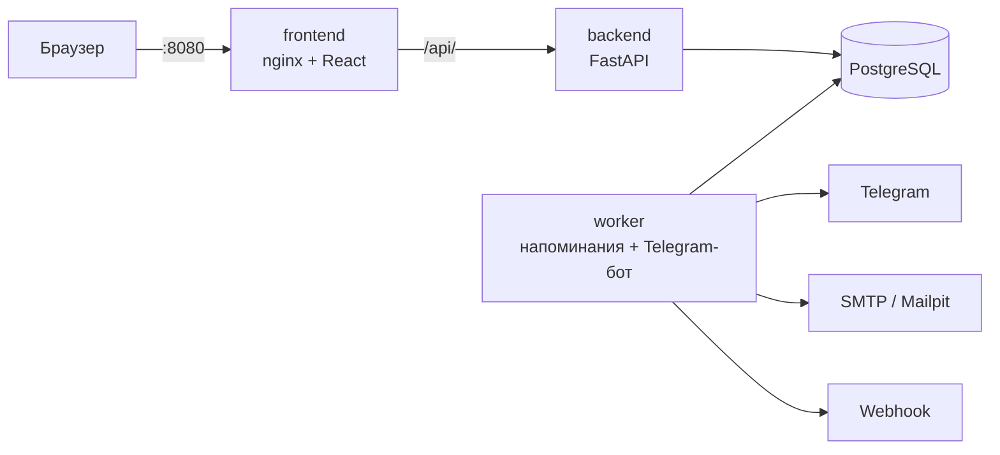

# Invoice Keeper — напоминания о регулярных платежах

Сервис, который не даёт забыть об аренде, подписках и оплате серверов. Администратор вносит регулярные
платежи в рублях, долларах и евро. За 3 дня до срока бот пишет в Telegram-чат команды, а команда отмечает
оплату в веб-панели или кнопкой прямо в сообщении. В любой момент видно, что и когда оплатить, что уже
оплачено и что просрочено.

## Попробовать

| | |
|---|---|
| **Работающий сайт** | **https://84.21.191.15** — вход тестовым пользователем: `anna` / `anna12345` |
| **Swagger (документация API)** | **https://84.21.191.15/api/v1/docs** |
| OpenAPI-спецификация | [`docs/openapi.yaml`](docs/openapi.yaml) |
| Архитектура и решения | [`ARCHITECTURE.md`](ARCHITECTURE.md) |
| Развёртывание на VPS с HTTPS | [`docs/deploy-vps.md`](docs/deploy-vps.md) |

**Стек:** Python 3.12, FastAPI, SQLAlchemy 2 (async), PostgreSQL 16, Alembic, APScheduler, aiogram ·
React 18, TypeScript, Vite, Mantine, TanStack Query · Docker Compose.

---

## Быстрый старт

Нужен только **Docker** с Compose v2: Docker Desktop на Windows/macOS или Docker Engine на Linux.

```bash
git clone https://github.com/Rolo909/kefcoders-invoice-keeper.git
cd kefcoders-invoice-keeper
cp .env.example .env
docker compose up --build -d
```

Первая сборка занимает 3–5 минут. Затем откройте **http://localhost:8080** и войдите администратором:
логин `admin`, пароль — `ADMIN_PASSWORD` из `.env` (в `.env.example` это `change-me`).
Swagger локально — http://localhost:8080/api/v1/docs.

`docker compose ps` — у `db` и `backend` статус `healthy`, у `worker`, `frontend`, `mailpit` — `running`.

`.env.example` работает без правок. При первом запуске создаются тестовые данные, а письма уходят в
локальный Mailpit (http://localhost:8025). Для Telegram-напоминаний впишите в `.env`
`TELEGRAM_BOT_TOKEN` и `TELEGRAM_CHAT_ID` (как получить — [ниже](#telegram)) и выполните `docker compose up -d`.
Без токена всё остальное работает: в истории периода видна причина, по которой напоминание не ушло,
а как только токен появится, ближайшая проверка его отправит.

| Действие | Команда |
|---|---|
| Остановить | `docker compose down` — данные в Docker-томе сохраняются |
| Начать с чистой базы | `docker compose down -v`, затем `docker compose up -d` |
| Логи напоминаний и бота | `docker compose logs -f worker` |

## Учётные записи

| Логин | Пароль | Роль |
|---|---|---|
| `admin` | `ADMIN_PASSWORD` из `.env` | администратор — задаётся только в `.env`, через панель и API не меняется |
| `anna` | `anna12345` | пользователь |
| `maria` | `maria12345` | пользователь |
| `user` | `user12345` | пользователь |

**Тестовые данные** — 13 регулярных платежей хостинг-провайдера в духе aeza.ru в трёх валютах.
Даты считаются от дня запуска, поэтому данные одинаково показательны в любой день:

| Платёж | Валюта | Что показывает |
|---|---|---|
| Аренда офиса, Санкт-Петербург | RUB | срок через 2 дня — напоминание уходит сразу после запуска |
| Бухгалтерское и налоговое сопровождение | RUB | срок завтра |
| IP-транзит, канал 10 Гбит/с | USD | текущий период просрочен, прошлые оплачены вовремя |
| Аренда стойки, Амстердам | EUR | оплата 31-го числа: в коротких месяцах — последний день; один период оплачен с опозданием |
| Страхование оборудования | RUB | ежеквартальный платёж |
| Домены aeza.ru и aeza.net | RUB | ежегодный платёж |
| Резервный канал связи | RUB | прекращённый платёж: история сохранена, напоминаний нет |

Бюджеты на месяц и год заданы по каждой валюте. Почта тестовых пользователей — в несуществующей зоне `.test`.
Пустая система — `SEED_DEMO_DATA=false` в `.env` и чистая база.

## Архитектура



| Сервис | Назначение |
|---|---|
| `frontend` | веб-панель; nginx отдаёт статику и проксирует `/api/` в backend |
| `backend` | REST API; при старте применяет миграции, синхронизирует администратора из `.env`, создаёт тестовые данные |
| `worker` | раз в минуту проверяет сроки и рассылает напоминания по каналам; Telegram-бот (long polling): кнопка «Оплачено», `/link` |
| `db` | PostgreSQL 16 |
| `mailpit` | почтовый сервер-ловушка для локальной проверки писем |

**Ключевые решения:**
- **Периоды хранятся, а не вычисляются на лету** — у каждого срока свой статус, фактическая дата, чеки и история.
- **Сумма и валюта копируются в период** — итоги прошлых периодов не меняются задним числом.
- **«Без дублей» обеспечивает база данных, а не память процесса** — уникальный ключ и захват отправки одним запросом.
- **Сессии — серверные** (непрозрачный токен в HttpOnly-cookie, в базе только хеш): выход и удаление пользователя сразу закрывают доступ.
- **Доменная логика отделена от фреймворков:** расчёт сроков и просрочки (`app/domain`) покрыт модульными тестами.

Подробнее — [`ARCHITECTURE.md`](ARCHITECTURE.md): модель данных, бизнес-правила, API, каналы уведомлений, принятые решения.

## Telegram

1. [@BotFather](https://t.me/BotFather) → `/newbot` → токен вида `123456789:AA…` — это `TELEGRAM_BOT_TOKEN`.
2. Добавьте бота в групповой чат команды и отправьте там `/start@имя_бота`.
3. **До запуска стека** откройте `https://api.telegram.org/bot<ТОКЕН>/getUpdates` и найдите `"chat":{"id":…}` —
   это `TELEGRAM_CHAT_ID` (у групп он отрицательный). Пока бот запущен, эта ссылка недоступна.
4. Впишите оба значения в `.env` и выполните `docker compose up -d`.

**Кто получает напоминание.** Сообщение приходит в общий чат. Тем, кто привязал Telegram в панели
(«Профиль» → «Получить код» → боту в личку `/link <код>`), но не состоит в чате, бот пишет в личку.

**Кнопка «Оплачено».** Работает только у привязанных пользователей. Одно нажатие обновляет все копии
сообщения — и в чате, и в личках.

## Настройки (`.env`)

| Переменная | По умолчанию | Назначение |
|---|---|---|
| `ADMIN_LOGIN`, `ADMIN_PASSWORD` | `admin`, — | единственный способ задать администратора (пароль от 8 символов) |
| `POSTGRES_DB`, `POSTGRES_USER`, `POSTGRES_PASSWORD` | — | база данных |
| `APP_TIMEZONE` | `Europe/Moscow` | единый часовой пояс сроков и просрочки |
| `REMIND_DAYS_BEFORE` | `3` | за сколько дней до срока напоминать |
| `REMINDER_CHECK_INTERVAL_MINUTES` | `1` | как часто worker проверяет сроки |
| `OCCURRENCE_HORIZON_DAYS` | `60` | на сколько дней вперёд создаются периоды (всегда есть хотя бы один будущий) |
| `SESSION_TTL_HOURS` | `168` | срок жизни сессии; продлевается при работе |
| `SEED_DEMO_DATA` | `true` | тестовые данные при первом запуске |
| `TELEGRAM_ENABLED`, `TELEGRAM_BOT_TOKEN`, `TELEGRAM_CHAT_ID` | `true`, —, — | напоминания в Telegram |
| `PUBLIC_WEB_URL` | `http://localhost:8080` | адрес панели для ссылок в Telegram и календаре |
| `EMAIL_ENABLED`, `SMTP_HOST`, `SMTP_PORT`, `SMTP_TLS`, `SMTP_USER`, `SMTP_PASSWORD`, `SMTP_FROM` | `true`, `mailpit`, `1025`, `false`, —, —, … | письма; по умолчанию — локальный Mailpit; для Gmail — `smtp.gmail.com`, `587`, `true` и пароль приложения |
| `EMAIL_EXTRA_RECIPIENTS` | — | адреса через запятую, получающие все напоминания |
| `WEBHOOK_URL`, `WEBHOOK_SECRET` | —, — | webhook и ключ подписи |
| `INAPP_ENABLED` | `true` | колокольчик в панели |
| `UPLOAD_MAX_MB` | `10` | максимальный размер чека |

## Развёртывание на сервере

[`docs/deploy-vps.md`](docs/deploy-vps.md) — пошаговая инструкция для Ubuntu:
- бесплатный сертификат Let's Encrypt на IP-адрес (домен не нужен) с автопродлением;
- наружу открыты только 80 и 443; nginx ограничивает частоту запросов и попыток входа с одного IP;
- бот защищён от флуда сообщениями;
- fail2ban, файрвол и автоматические обновления безопасности.

## Структура репозитория

```
backend/              API, worker и бот (Python)
  app/domain/         расчёт сроков и просрочки — без зависимостей от фреймворков
  app/services/       бизнес-логика: платежи, периоды, напоминания, итоги, каналы
  app/api/v1/         HTTP-эндпоинты
  alembic/            миграции базы данных
  tests/              unit, integration, api, contract
frontend/             веб-панель (React); работает и на имитации API — см. frontend/README.md
e2e/                  сквозные тесты в браузере (Playwright)
deploy/               nginx для сервера
docs/                 openapi.yaml, развёртывание на VPS
docker-compose.yml    запуск всего одной командой
```
