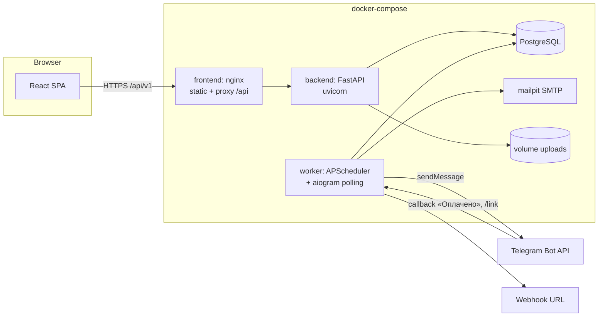
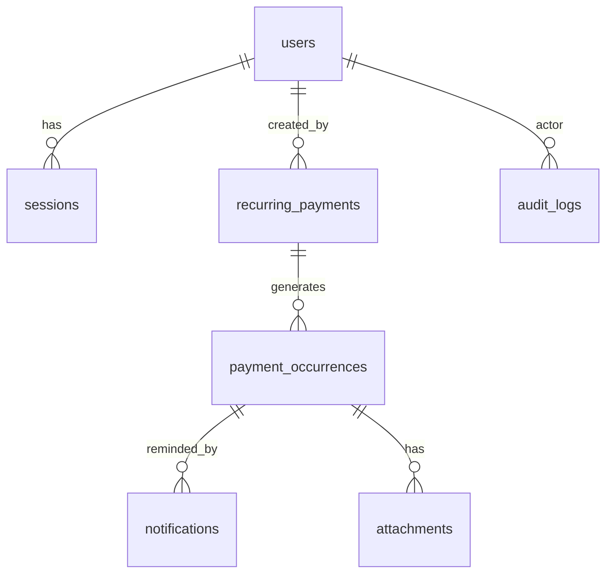
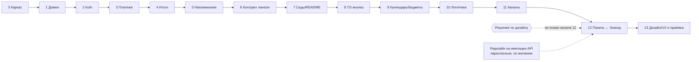

# TASK_PLAN — Invoice Keeper

Напоминания о регулярных платежах. Хакатон РнД, уровень Middle.

Документ — полный план реализации: разбор кейса, стек, архитектура, модель данных,
бизнес-правила, API, фоновые задачи, фронтенд, поэтапный план с критериями проверки
и трассировка требований кейса → реализация.

---

## 0. Разбор кейса

### 0.1 Суть
Система, которая не даёт забыть о регулярных платежах (аренда, подписки, серверы).
- **Администратор** вносит регулярные платежи, управляет пользователями.
- **Система** минимум за 3 дня до срока пишет в Telegram-чат.
- **Пользователи** видят общий список, отмечают оплату, следят за просрочками.
- Ответ системы: *что и когда оплатить, что уже оплачено, что просрочено.*

### 0.2 Ключевые параметры
| Параметр | Значение |
|---|---|
| Напоминание | ≥ 3 дня до срока, в Telegram-чат |
| Роли | 2: администратор (из `.env`) и пользователь |
| Валюты | RUB, USD, EUR; итоги **отдельно по каждой валюте**; без конвертации и курсов |
| Периодичность | обязательно — ежемесячно; другие — на усмотрение (делаем weekly/monthly/quarterly/yearly) |
| Часовой пояс | единый, задаётся в `.env` |
| Нет числа в месяце | последний день месяца (31 → 28/29/30) |

### 0.3 Бизнес-правила (обязательные, дословный смысл кейса)
1. **Регулярный платёж** — повторяющийся расход; у **каждого периода** своя дата оплаты и своя отметка «Оплачено / Не оплачено».
2. **Оплачено** — оплата подтверждена и указана **фактическая дата**.
3. **Не оплачено** — оплата не подтверждена; **при отмене отметки фактическая дата очищается**.
4. **Просрочка** — со **следующего дня** после срока. Оплата **в день срока — вовремя**.
5. Исправили фактическую дату → просрочка **пересчитывается**, срок (due date) **не меняется**.
6. Новый период **не стирает** прошлые оплаты; просрочка **не останавливает** следующие периоды.
7. Отметка оплаты — только для **конкретного периода**. История оплат сохраняется.
8. Напоминание: название, сумма, валюта, дата. **Без дублей.** Оплаченный период — без напоминания.
9. Платёж добавлен позже, чем за 3 дня до срока → напоминание **сразу**.
10. **Удалённый** регулярный платёж больше не создаёт напоминаний (история сохраняется).
11. Администратор задаётся через `.env`; его учётку **через панель/API не изменить**.
12. Ограничения прав действуют **и в веб-панели, и в API**.
13. Без авторизации панель и данные недоступны.
14. Всё сохраняется после перезапуска.

### 0.4 Матрица прав
| Действие | Пользователь | Администратор |
|---|:-:|:-:|
| Вход / выход / `me` | ✅ | ✅ |
| Смотреть регулярные платежи и периоды, итоги, календарь | ✅ | ✅ |
| Отметить / отменить оплату, указать / исправить фактическую дату | ✅ | ✅ |
| Прикрепить чек / ссылку к оплате | ✅ | ✅ |
| Создать / удалить (прекратить) регулярный платёж | ❌ 403 | ✅ |
| Создать / изменить / удалить обычного пользователя | ❌ 403 | ✅ |
| Изменить / удалить администратора из `.env` | ❌ | ❌ 403 |
| Журнал действий (audit log), бюджеты (изменение) | ❌ 403 | ✅ |

### 0.5 Критерии приёмки (чек-лист, на который ориентируем весь план)
- [ ] Запуск по README (полная инструкция; жюри запускает само).
- [ ] Без авторизации панель и данные недоступны.
- [ ] Пользователь не выполнит действия администратора — даже через API.
- [ ] Следующий период — с отдельным статусом; прошлые периоды сохраняются.
- [ ] Напоминания минимум за 3 дня, без дублей; оплаченный период — без напоминания.
- [ ] Оплату можно отметить и отменить; исправление даты убирает ошибочную просрочку.
- [ ] RUB, USD, EUR; итоги отдельно по каждой валюте.
- [ ] Всё сохраняется после перезапуска; удалённый платёж не напоминает.
- [ ] Передача: код, инструкция запуска, `.env.example` без секретов, тестовые данные.
- [ ] OpenAPI-спецификация файлом (`.yml`/`.json`) + рабочий Swagger на `/api/v1/docs`.

### 0.6 Сценарий демонстрации (защита) — должен проходить вживую
1. Войти администратором. 2. Добавить регулярный платёж. 3. Получить напоминание в Telegram.
4. Войти пользователем и отметить оплату. 5. Показать просроченный платёж.
6. Исправить фактическую дату оплаты. 7. Показать следующий период с отдельным статусом.

### 0.7 Дополнительные фичи
В кейсе их девять (слайд 16). Берём все девять:
| # | Фича (как в кейсе) | Пояснение в кейсе | В плане |
|---|---|---|---|
| 1 | Кнопка «Оплачено» | прямо в сообщении Telegram-бота | этап 8 |
| 2 | Календарь оплат | итоги на дату по валютам | этап 9 |
| 3 | Бюджет на месяц и год | плановые расходы по каждой валюте | этап 9 |
| 4 | Email-оповещения | через SMTP | этап 11 |
| 5 | Webhook | на указанный адрес | этап 11 |
| 6 | Другие каналы | на усмотрение команды | этап 11: **уведомления в веб-панели** (колокольчик со счётчиком непрочитанных), §7 |
| 7 | Чек или ссылка | прикрепляются к конкретной оплате | этап 10 |
| 8 | Логи | авторизация и действия | этап 10 |
| 9 | Проработанный UX/UI | удобство интерфейса и взаимодействия | наработка `frontend/` (§9.0), этапы 12–13 |

> Дополнительные функции не заменяют обязательные: сначала закрываем этапы 1–7, затем extras.

---

## 1. Стек технологий

| Слой | Технология | Почему |
|---|---|---|
| Backend API | **Python 3.12, FastAPI** | авто-OpenAPI + Swagger, Pydantic-валидация, быстро |
| ORM / миграции | **SQLAlchemy 2.0 (async) + asyncpg, Alembic** | типизированные модели, версионируемая схема |
| БД | **PostgreSQL 16** | надёжность, `ON CONFLICT`, advisory locks, персистентность |
| Пароли | **argon2** (`pwdlib[argon2]`) | современный хеш |
| Сессии | opaque-токен в таблице `sessions`, HttpOnly cookie **и** `Authorization: Bearer` | реальный logout (отзыв сессии), удобно и для SPA, и для Swagger |
| Telegram-бот | **aiogram 3** (long polling) | отправка сообщений + inline-кнопка «Оплачено» |
| Планировщик | **APScheduler 3** (AsyncIOScheduler) в отдельном процессе `worker` | один исполнитель задач, нет дублей при нескольких воркерах API |
| Email | `aiosmtplib`; в docker-compose — **Mailpit** (SMTP-ловушка с веб-UI) | демонстрация без реального SMTP |
| Webhook | `httpx` + подпись HMAC-SHA256 | |
| Frontend | **React 18 + Vite + TypeScript** | |
| UI-кит | **Mantine 7** (+ `@mantine/dates`, `@mantine/notifications`) | готовые таблицы, формы, календарь, тёмная тема |
| Данные на фронте | **TanStack Query 5**, `react-router 6`, `react-hook-form` + `zod` | кеш/инвалидация, формы с валидацией |
| Типы API на фронте | рукописные `frontend/src/api/types.ts` (уже есть) + сверка с `docs/openapi.yaml` на этапе 12 | контракт зафиксирован в наработке веб-панели (§5.4) |
| Имитация API | **MSW 2** (`frontend/src/mocks`, уже есть) | панель работает и переделывается без бэкенда |
| Тесты | **pytest + pytest-asyncio + httpx.AsyncClient**, `time-machine` (заморозка даты), Postgres в docker; фронт — Vitest; e2e — Playwright (по возможности) | |
| Линт | ruff, mypy (backend); eslint + tsc (frontend) | |
| Запуск | **Docker Compose**: `db`, `backend`, `worker`, `frontend` (nginx), `mailpit` | один шаг запуска для жюри |

---

## 2. Архитектура

### 2.1 Компоненты и процессы



- **backend** — HTTP API, бизнес-правила, авторизация, Swagger. На старте: `alembic upgrade head` → синхронизация админа из `.env` → (опционально) сид демо-данных.
- **worker** — один процесс: планировщик (генерация периодов, напоминания, ретраи) + Telegram-бот (polling: кнопка «Оплачено», команда `/link`). Использует **те же сервисы** доменного слоя, что и API (общий Python-пакет `app`).
- Мгновенное напоминание при создании платежа (правило 9): после коммита API сам вызывает `ReminderService.dispatch_for_payment(payment_id)` в `BackgroundTasks` (отправка через Bot API — обычный HTTP-вызов, polling-процесс для этого не нужен). Дубли исключены уникальным ключом в `notifications` (см. §4.4), поэтому параллельный запуск worker + API безопасен.

### 2.2 Слои backend (упрощённая clean architecture)

```
api (routers, схемы Pydantic, зависимости auth)      ← зависит от ↓
services (use-cases: occurrences, reminders, auth, users, summary, audit)
domain (чистые функции и enum: расчёт дат, статус/просрочка, деньги)  ← без зависимостей
infrastructure (SQLAlchemy-модели и репозитории, telegram/email/webhook-клиенты, storage)
```
Правила: `domain` не импортирует ничего из FastAPI/SQLAlchemy; роутеры не содержат бизнес-логики; права проверяются зависимостями `require_user` / `require_admin` на уровне API **и** повторно в сервисах для критичных операций (например, защита env-админа).

### 2.3 Структура репозитория
```
.
├── README.md                 # полная инструкция запуска (для жюри)
├── TASK_PLAN.md
├── .env.example              # все переменные, без секретов
├── docker-compose.yml
├── docs/
│   ├── openapi.yaml          # экспорт спецификации (обязательный артефакт)
│   └── demo-scenario.md      # шаги защиты с готовыми логинами
├── backend/
│   ├── Dockerfile
│   ├── pyproject.toml
│   ├── alembic.ini, alembic/versions/
│   ├── entrypoint.sh         # migrate → bootstrap admin → seed → uvicorn
│   ├── app/
│   │   ├── main.py           # FastAPI app, docs_url=/api/v1/docs, openapi_url=/api/v1/openapi.json
│   │   ├── config.py         # pydantic-settings, валидация .env
│   │   ├── db.py             # engine, session factory
│   │   ├── domain/
│   │   │   ├── schedule.py   # due_date(anchor, period, n), dates_in_range(...)
│   │   │   ├── status.py     # is_overdue, state, days_overdue
│   │   │   └── enums.py      # Currency, Period, Role, OccurrenceStatus, Channel
│   │   ├── models/           # SQLAlchemy: user, session, recurring_payment, occurrence,
│   │   │                     # notification, attachment, audit_log, budget, telegram_link_code
│   │   ├── repositories/
│   │   ├── services/
│   │   │   ├── auth.py, users.py, recurring_payments.py, occurrences.py,
│   │   │   ├── reminders.py, summary.py, audit.py, attachments.py, budgets.py
│   │   │   └── notifiers/ (telegram.py, email.py, webhook.py, formatting.py)
│   │   ├── api/v1/           # auth, recurring_payments, occurrences, payments_summary,
│   │   │                     # users, attachments, audit_logs, budgets, telegram, health
│   │   ├── bot/handlers.py   # aiogram: /start, /link CODE, callback pay:<id>
│   │   ├── worker.py         # точка входа worker: scheduler + bot polling
│   │   ├── bootstrap.py      # upsert env-админа
│   │   ├── seed.py           # идемпотентные демо-данные
│   │   └── scripts/export_openapi.py
│   └── tests/ (unit/, api/, conftest.py)
└── frontend/                 # УЖЕ ЕСТЬ (наработка, §9.0)
    ├── Dockerfile            # node:20 build (VITE_API_MOCK=false) → nginx:alpine :8080
    ├── nginx.conf            # SPA fallback + proxy /api/ → backend:8000, client_max_body_size 12m
    ├── .env.development      # VITE_API_MOCK=true — dev-режим на имитации API
    ├── package.json, vite.config.ts (proxy /api → API_PROXY_TARGET при VITE_API_MOCK=false)
    ├── public/mockServiceWorker.js
    └── src/
        ├── api/              # СЛОЙ КОНТРАКТА: client.ts, hooks.ts (TanStack Query), types.ts
        ├── auth/             # AuthProvider, RequireAuth, RequireAdmin
        ├── lib/              # dates.ts, format.ts, audit.ts (+ тесты Vitest)
        ├── mocks/            # MSW: db.ts (правила §4 в браузере), handlers.ts (все эндпоинты §5)
        ├── pages/            # СЛОЙ ДИЗАЙНА: Dashboard, Occurrences, Occurrence, Payments, Payment,
        │                     #   Calendar, Summary, Users, Audit, Settings, Login, NotFound
        ├── components/       # СЛОЙ ДИЗАЙНА: AppLayout, Bell, dialogs/*, Marks, CountUp, ...
        ├── styles/ledger.css, theme.ts   # СЛОЙ ДИЗАЙНА
        └── App.tsx, main.tsx
```

---

## 3. Модель данных



### 3.1 Таблицы
**users**
| поле | тип | примечание |
|---|---|---|
| id | uuid PK | |
| login | varchar(64), уникальный индекс по `lower(login)` | без учёта регистра; расширение citext не нужно |
| password_hash | text | argon2 |
| full_name | varchar(128) null | |
| email | varchar(255) null | для email-оповещений |
| role | enum `admin`/`user` | |
| is_system | bool | `true` только у админа из `.env` → неизменяем через API |
| telegram_user_id | bigint null unique | привязка для кнопки «Оплачено» |
| notify_email | bool default false | |
| created_at, updated_at | timestamptz | |

**sessions** — `id`, `token_hash` (sha256 от токена, unique), `user_id` FK on delete cascade, `created_at`, `expires_at`, `last_seen_at`, `user_agent`, `ip`.

**recurring_payments**
| поле | тип | примечание |
|---|---|---|
| id | uuid PK | |
| name | varchar(200) | |
| description | text null | |
| amount | numeric(14,2) > 0 | никаких float |
| currency | enum `RUB`/`USD`/`EUR` | |
| period | enum `weekly`/`monthly`/`quarterly`/`yearly` | обязательная часть — `monthly` |
| first_due_date | date | **якорь**: из него берётся день месяца |
| end_date | date null | опционально «до даты» |
| is_active | bool | |
| deleted_at | timestamptz null | мягкое удаление = прекращение |
| created_by | FK users | |
| created_at | timestamptz | |

**payment_occurrences** (период)
| поле | тип | примечание |
|---|---|---|
| id | uuid PK | |
| recurring_payment_id | FK | |
| seq | int | номер периода n (0, 1, 2…) |
| due_date | date | **никогда не меняется** через API |
| amount, currency | snapshot | копия на момент генерации — история не «плывёт» |
| status | enum `unpaid`/`paid` | |
| paid_date | date null | фактическая дата; `NULL` ⇔ `unpaid` (CHECK) |
| paid_by | FK users null | |
| paid_marked_at | timestamptz null | |
| note | text null | |
| UNIQUE(recurring_payment_id, seq) | | защита от дублей периодов |
| CHECK((status='paid') = (paid_date IS NOT NULL)) | | инвариант правил 2–3 |

Индексы: `(due_date)`, `(status, due_date)`, `(recurring_payment_id, due_date)`.

**notifications** (журнал и идемпотентность напоминаний)
`id`, `occurrence_id` FK, `channel` enum `telegram/email/webhook/inapp`, `kind` enum `before_due/overdue`, `status` enum `pending/sent/failed`, `attempts` int, `last_error` text, `sent_at`, `telegram_message_id`, `created_at`.
**UNIQUE(occurrence_id, channel, kind)** — ядро правила «без дублей».

**attachments** — `id`, `occurrence_id` FK, `kind` `file/link`, `url` null, `file_path` null, `original_name`, `content_type`, `size`, `uploaded_by`, `created_at`.

**audit_logs** — `id`, `at`, `actor_id` null, `actor_login`, `action` (`auth.login`, `auth.login_failed`, `auth.logout`, `payment.create`, `payment.delete`, `occurrence.mark_paid`, `occurrence.mark_unpaid`, `occurrence.change_paid_date`, `user.create/update/delete`, `attachment.add/delete`, `telegram.mark_paid`), `entity_type`, `entity_id`, `details` jsonb, `ip`.

**notification_reads** — `user_id` FK, `notification_id` FK, `read_at`; PK(user_id, notification_id). Отметки «прочитано» для канала `inapp`: само уведомление одно на период (общая лента), прочитанность — у каждого пользователя своя.

**budgets** — `id`, `currency`, `period_type` `month/year`, `year`, `month` null, `amount`; UNIQUE(currency, period_type, year, month).

**telegram_link_codes** — `code` (6–8 символов), `user_id`, `expires_at` (10 мин), `used_at`.

### 3.2 Миграции
Одна стартовая миграция Alembic со всеми таблицами/enum/constraint; далее — по необходимости. Применяются автоматически в `entrypoint.sh`.

---

## 4. Ключевая доменная логика (самое важное для корректности)

### 4.1 Расчёт дат периодов — `domain/schedule.py`
Даты всегда считаются **от якоря**, а не от предыдущей даты (иначе 31.01 → 28.02 → 28.03 — ошибка).
```python
def due_date(first_due: date, period: Period, n: int) -> date:
    if period is Period.WEEKLY:
        return first_due + timedelta(weeks=n)
    months = {MONTHLY: 1, QUARTERLY: 3, YEARLY: 12}[period] * n
    y, m = divmod(first_due.month - 1 + months, 12)
    year, month = first_due.year + y, m + 1
    day = min(first_due.day, calendar.monthrange(year, month)[1])  # нет числа → последний день
    return date(year, month, day)
```
Обязательные unit-тесты: 31.01 → 28.02 (29.02 в високосный) → 31.03 → 30.04; 30.01 → 28.02 → 30.03; 29.02 (yearly) → 28.02 следующего года → 29.02 через 4 года; weekly/quarterly.

`dates_in_range(payment, from, to)` — для плановых расходов/календаря будущего без материализации.

### 4.2 Материализация периодов — `services/occurrences.py`
- **Горизонт**: для каждого активного платежа в БД существуют все периоды с `due_date <= today + HORIZON_DAYS` (по умолчанию 60) **и всегда минимум один будущий** (`due_date > today`) — это даёт «следующий период с отдельным статусом» (демо, шаг 7).
- `ensure_occurrences(payment)` идемпотентна: находит max(seq), досоздаёт недостающие через `INSERT … ON CONFLICT (recurring_payment_id, seq) DO NOTHING`.
- Вызывается: при создании платежа (в той же транзакции), периодически worker'ом (каждый час + при старте), перед чтением списка/календаря (дёшево, защищает от «пропущенного» запуска worker'а).
- Статус и просрочка прошлых периодов **никак не влияют** на генерацию следующих (правило 6). Новые периоды создаются со `status=unpaid`, существующие не трогаются.
- Если `first_due_date` в прошлом — создаются все прошлые периоды (они станут просроченными, если не оплачены) — удобно для демо шага 5.

### 4.3 Статус и просрочка — `domain/status.py`
`today` = `datetime.now(ZoneInfo(APP_TIMEZONE)).date()` — **единый пояс из `.env`**, никаких `date.today()` по системному времени контейнера.
```python
def is_overdue(o, today):
    if o.status == PAID:
        return o.paid_date > o.due_date          # оплачено позже срока
    return today > o.due_date                     # со следующего дня после срока

def state(o, today):  # для UI/фильтров
    paid → "paid" | "paid_late"
    unpaid → "overdue" если today > due; "due_soon" если due - today <= REMIND_DAYS; иначе "upcoming"
```
- Оплата в день срока (`paid_date == due_date`) — вовремя.
- Исправление `paid_date` на дату ≤ срока **убирает** просрочку (правило 5) — поле вычисляемое, ничего «залипшего» не хранится.
- `days_overdue` = `(paid_date or today) - due_date` при положительном значении.
- Поля `is_overdue`, `state`, `days_overdue` отдаются в API как вычисляемые; фильтр `overdue=true` реализован SQL-выражением с тем же смыслом (`(status='unpaid' AND due_date < :today) OR (status='paid' AND paid_date > due_date)`). Тест сверяет SQL-фильтр с Python-функцией.

### 4.4 Изменение оплаты — `PATCH /payment-occurrences/{id}`
Тело: `{ "status": "paid" | "unpaid", "paid_date": "YYYY-MM-DD" | null }` (оба опциональны).
| Запрос | Результат |
|---|---|
| `status=paid`, без даты | `paid_date = today` |
| `status=paid`, `paid_date=X` | `paid_date = X` |
| только `paid_date=X` при `paid` | исправление фактической даты |
| только `paid_date` при `unpaid` | **409**, `code: "not_paid"` «сначала отметьте оплату» |
| ни `status`, ни `paid_date` | 422 `validation_error` |
| `status=paid` для уже оплаченного + другая дата | исправление даты (audit `occurrence.change_paid_date`) |
| `status=unpaid` | `paid_date = NULL`, `paid_by = NULL` (правило 3) |
Валидация: `paid_date <= today` (в будущем — 422). `due_date`, `amount`, `currency` в PATCH **не принимаются** (`extra="forbid"`). Каждая смена пишется в audit log с old/new значениями. Периоды удалённого платежа остаются доступными для просмотра и исправлений истории.

### 4.5 Напоминания — `services/reminders.py`
Отбор кандидатов (SQL):
```
occurrence.status = 'unpaid'
AND payment.deleted_at IS NULL AND payment.is_active
AND occurrence.due_date >= today
AND occurrence.due_date <= today + REMIND_DAYS_BEFORE   -- по умолчанию 3
AND NOT EXISTS (notification с тем же occurrence_id, channel, kind='before_due' и status='sent')
```
Алгоритм отправки (на каждый канал: telegram обязательно; inapp включён по умолчанию; email/webhook если настроены):
1. `INSERT INTO notifications(..., status='pending') ON CONFLICT DO NOTHING RETURNING id` — если строки не вернулось и существующая уже `sent`/в работе — пропуск. **Это гарантирует «без дублей» даже при одновременном запуске worker и API.**
2. Отправить. Успех → `status='sent'`, `sent_at`, `telegram_message_id`. Ошибка → `status='failed'`, `attempts+1`, `last_error`; повтор на следующем тике (до `MAX_ATTEMPTS=5`), строку повторно захватываем через `UPDATE … WHERE status='failed' AND attempts < 5 RETURNING` (атомарно).
3. Перед отправкой — повторная проверка, что период всё ещё `unpaid` и платёж не удалён.

Запуск:
- worker: каждые `REMINDER_CHECK_INTERVAL_MINUTES` (по умолчанию 1–5 мин) + сразу при старте. Защита от параллельных тиков — `pg_try_advisory_xact_lock`.
- API: после `POST /recurring-payments` — `BackgroundTasks` → `dispatch_for_payment(id)` → напоминание **сразу**, если срок ближе 3 дней (правило 9).
- Оплаченный период: отбор по `status='unpaid'` → не напоминаем. Отметили оплату и сняли → напоминание уже было `sent` → дубль не создаётся.
- Удалённый платёж: отбор по `deleted_at IS NULL` + будущие неоплаченные периоды удаляются (см. 4.6).
- Extra: `kind='overdue'` — одно сообщение «Просрочено» на следующий день после срока (тот же механизм уникальности).

Формат сообщения (HTML parse_mode, экранирование имени):
```
🔔 Напоминание об оплате
<b>Аренда офиса</b>
Сумма: 50 000,00 RUB
Срок оплаты: 25.10.2026 (через 2 дня)
[✅ Оплачено]   [Открыть в панели]
```

### 4.6 Удаление (прекращение) регулярного платежа — `DELETE /recurring-payments/{id}`
- Мягкое удаление: `deleted_at = now()`, `is_active = false`.
- Периоды с `due_date <= today` или `status='paid'` **сохраняются** (история).
- Будущие неоплаченные периоды (`due_date > today AND status='unpaid'`) удаляются, их `pending/failed` уведомления удаляются каскадом.
- Генерация новых периодов и напоминания прекращаются (фильтр `deleted_at IS NULL`).
- Повторный DELETE → 404 (или 204 идемпотентно — выбираем **204**, фиксируем в OpenAPI).
- `GET /recurring-payments` по умолчанию скрывает удалённые; `?include_deleted=true` — показывает (для истории).

### 4.7 Итоги по валютам — `GET /payments/summary`
Параметры: `date_from`, `date_to` (по умолчанию — текущий месяц), `as_of` (итоги на дату, extra).
Ответ — **массив по валютам, всегда все три**, без конвертации:
```json
{ "period": {"from": "2026-10-01", "to": "2026-10-31"}, "as_of": "2026-10-23",
  "totals": [
    {"currency": "RUB", "planned": "50000.00", "paid": "0.00", "unpaid": "50000.00",
     "overdue": "0.00", "paid_late": "0.00", "count_total": 1, "count_paid": 0, "count_overdue": 0,
     "budget": "60000.00", "budget_left": "10000.00"},
    {"currency": "USD", ...}, {"currency": "EUR", ...}] }
```
Суммирование — `numeric` в SQL с `GROUP BY currency`; `planned` для будущих месяцев за горизонтом — через `dates_in_range` (плановые расходы, extra). Семантика полей (совпадает с имитацией API в `frontend/src/mocks/handlers.ts`, функция `totals`):
- `planned` = сумма созданных периодов в `[date_from, date_to]` + плановые сроки без созданных периодов; `count_total` — их количество.
- «оплачен на дату» = `status='paid' AND paid_date <= as_of` (`as_of` по умолчанию — сегодня).
- `paid` = сумма оплаченных на дату; `unpaid` = `planned − paid`.
- `overdue` = **только неоплаченное** на дату с `due_date < as_of`; `count_overdue` — их число.
- `paid_late` = оплаченное на дату с `paid_date > due_date` (отдельно от `overdue`).
- `budget` = бюджет валюты на месяц (`null`, если не задан); `budget_left = budget − planned`.

### 4.8 Авторизация и админ из `.env`
- `bootstrap.py` при старте: upsert пользователя `ADMIN_LOGIN` с `role=admin, is_system=true`, пароль из `ADMIN_PASSWORD` (перехешируется, если изменился). Если логин админа в `.env` сменили — прежний system-админ деактивируется (удаляются его сессии, `is_system` переносится).
- `POST /users` всегда создаёт `role=user` (поле `role` в схеме отсутствует). Создать админа через API невозможно.
- `PATCH/DELETE /users/{id}` для `is_system=true` → **403**. Пользователь не может удалить сам себя через этот эндпоинт.
- `POST /auth/login` → `{access_token, token_type, expires_at, user}` + `Set-Cookie: ik_session=…; HttpOnly; SameSite=Lax; Path=/`. Токен — `secrets.token_urlsafe(32)`, в БД хранится sha256. TTL `SESSION_TTL_HOURS` (по умолчанию 168), скользящее продление.
- Зависимость `current_user` принимает cookie **или** `Authorization: Bearer` (Swagger — кнопка Authorize через `HTTPBearer`).
- `POST /auth/logout` удаляет сессию + чистит cookie. Удаление/изменение пароля пользователя админом удаляет все его сессии.
- Неверный логин/пароль → 401 с одинаковым сообщением; простой rate-limit (5 попыток/мин на логин+IP, in-memory или в БД) и запись `auth.login_failed` в audit.
- CSRF: cookie `SameSite=Lax` + все мутации — JSON (`Content-Type: application/json`) / multipart с проверкой `Origin` для cookie-аутентификации.
- Все эндпоинты кроме `/auth/login`, `/health`, `/docs`, `/openapi.json` требуют авторизации (глобальная зависимость роутера v1 + явные исключения). Тест перебирает все маршруты из `app.routes` и проверяет 401 без токена.

---

## 5. API (контракт)

Общее: префикс **`/api/v1`**; ошибки в едином формате `{"detail": "...", "code": "..."}`; деньги — строки с 2 знаками; даты — `YYYY-MM-DD`; списки — `{items, total, limit, offset}`.

### 5.1 Обязательные эндпоинты
| Метод | Путь | Назначение | Роль |
|---|---|---|---|
| POST | `/api/v1/auth/login` | вход по логину и паролю | все |
| GET | `/api/v1/auth/me` | текущий пользователь | auth |
| POST | `/api/v1/auth/logout` | завершение текущей сессии | auth |
| GET | `/api/v1/recurring-payments` | список регулярных платежей (`include_deleted`, `currency`, `q`) + ближайший период | auth |
| POST | `/api/v1/recurring-payments` | создание регулярного платежа | admin |
| DELETE | `/api/v1/recurring-payments/{id}` | прекращение платежа и напоминаний с сохранением истории | admin |
| GET | `/api/v1/payment-occurrences` | список периодов: фильтры `status`, `overdue`, `state`, `date_from`, `date_to`, `currency`, `recurring_payment_id`, сортировка, пагинация | auth |
| GET | `/api/v1/payment-occurrences/{id}` | конкретный период | auth |
| PATCH | `/api/v1/payment-occurrences/{id}` | подтверждение/отмена оплаты, исправление фактической даты | auth |
| GET | `/api/v1/payments/summary` | итоговые суммы по валютам | auth |
| GET | `/api/v1/users` | список пользователей | admin |
| POST | `/api/v1/users` | создание обычного пользователя | admin |
| PATCH | `/api/v1/users/{id}` | изменение пользователя (логин, ФИО, email, пароль) | admin |
| DELETE | `/api/v1/users/{id}` | удаление пользователя | admin |
| GET | `/api/v1/docs` | Swagger UI | публично |
| GET | `/api/v1/openapi.json` | OpenAPI JSON | публично |

> Таблица сверена со слайдами 12–14 (.pptx и скриншоты): на слайдах 15 маршрутов (3 + 6 + 6), все они в таблице выше; `/api/v1/openapi.json` добавлен нами — его использует Swagger UI. «Получение конкретного платежа» на слайде 13 — это `GET /payment-occurrences/{id}` (конкретный период). Отдельного `GET /recurring-payments/{id}` на слайдах нет, поэтому он в §5.2 как дополнительный — но реализуется в любом случае (нужен для страницы платежа с историей периодов).

`POST /recurring-payments` тело: `{name, description?, amount: "50000.00", currency, period: "monthly", next_due_date, end_date?}`. `next_due_date` — «дата ближайшей оплаты» из кейса (слайд 4); в БД сохраняется как якорь `first_due_date`. Ответ 201: платёж + `next_occurrence`. Валидация: `amount > 0`, ≤ 2 знаков, `currency ∈ {RUB,USD,EUR}`, `name` 1–200.

### 5.2 Дополнительные эндпоинты (extras)
| Метод | Путь | Назначение | Роль |
|---|---|---|---|
| GET | `/api/v1/recurring-payments/{id}` | конкретный регулярный платёж + его периоды (история) | auth |
| GET | `/api/v1/payments/calendar?month=2026-10` | периоды по дням + будущие плановые | auth |
| GET/PUT | `/api/v1/budgets` | бюджеты по валютам на месяц/год | GET auth / PUT admin |
| GET | `/api/v1/payment-occurrences/{id}/attachments` | список чеков/ссылок | auth |
| POST | `/api/v1/payment-occurrences/{id}/attachments` | multipart-файл (pdf/png/jpg/webp, ≤ 10 МБ) **или** JSON `{url}` | auth |
| GET | `/api/v1/attachments/{id}/download` | скачивание файла (с проверкой auth) | auth |
| DELETE | `/api/v1/attachments/{id}` | удалить (автор или admin) | auth |
| GET | `/api/v1/audit-logs` | журнал: фильтры по действию, пользователю, дате | admin |
| GET | `/api/v1/notifications` | журнал отправленных напоминаний (канал, статус, ошибка) | admin |
| POST | `/api/v1/telegram/link-code` | код привязки Telegram для текущего пользователя | auth |
| GET | `/api/v1/inbox?unread_only=true` | лента уведомлений в панели (канал `inapp`) + `unread_count` | auth |
| POST | `/api/v1/inbox/{id}/read` | отметить уведомление прочитанным | auth |
| POST | `/api/v1/inbox/read-all` | отметить все прочитанными | auth |
| POST | `/api/v1/notifications/test` | тестовое сообщение во все каналы (проверка настроек) | admin |
| GET | `/api/v1/health` | liveness/readiness (БД) | публично |

### 5.3 OpenAPI-артефакт
- FastAPI: `FastAPI(docs_url="/api/v1/docs", openapi_url="/api/v1/openapi.json", redoc_url=None)`, теги, описания, примеры (`json_schema_extra`), коды ответов 401/403/404/409/422 в `responses=`.
- `python -m app.scripts.export_openapi > docs/openapi.yaml` (PyYAML). Файл коммитится.
- Тест `test_openapi_up_to_date` — сравнивает сгенерированную схему с `docs/openapi.yaml` (не даёт артефакту устареть).
- Фронтенд использует свои рукописные типы `src/api/types.ts`; на этапе 12 они сверяются с `docs/openapi.yaml` (§5.4, п. «Сверка»).

### 5.4 Контракт веб-панели (обязательно для бэкенда)
Веб-панель уже написана против имитации API (`frontend/src/mocks`), её ожидания описаны в `frontend/README.md` («Что фронтенд ждёт от бэкенда») и типах `frontend/src/api/types.ts`. **Бэкенд реализует ровно этот контракт** — тогда подключение панели на этапе 12 сводится к переключению `VITE_API_MOCK=false`, а не к переделке UI. Источник правды при расхождении: `types.ts` + `handlers.ts` для формы ответов, этот план — для бизнес-правил.

**Дополнительные эндпоинты, которых нет в §5.1–5.2:**
| Метод | Путь | Назначение | Роль |
|---|---|---|---|
| PATCH | `/api/v1/auth/me` | `{email, notify_email}` — пользователь меняет свою почту; system-админ → 403 `system_user`; `notify_email=true` без email → 422 | auth |

**Формы ответов:**
- `GET /auth/me` → `{ user, server_today, timezone }`; `server_today` считается в `APP_TIMEZONE`. Фронтенд берёт «сегодня» только отсюда.
- `User` = `{id, login, full_name, email, role, is_system, telegram_linked: bool, notify_email, created_at}` — **`telegram_linked` вместо `telegram_user_id`** (id в Telegram наружу не отдаём).
- `POST /auth/login` → `{access_token, token_type: "bearer", expires_at, user}`.
- `Occurrence` дополнительно к полям §3.1: `recurring_payment: {id, name, period, is_deleted}`, `paid_by: {id, login, full_name} | null`, вычисляемые `is_overdue`, `state`, `days_overdue`, а также `attachments_count` и `last_reminder_at` (время последнего `sent` уведомления `telegram/before_due`).
- `GET /payment-occurrences/{id}` → `OccurrenceDetail` = `Occurrence` + `history` (записи audit по этому периоду, `entity_type='occurrence'`) + `reminders` (все `notifications` по периоду, новые сверху).
- `RecurringPayment` = поля §3.1 + `created_by: UserBrief` + `next_occurrence: Occurrence | null`; `GET /recurring-payments/{id}` → + `occurrences[]` (новые сверху). Список: сначала активные, затем прекращённые; внутри — по ближайшему сроку.
- Все списки — `Page<T> = {items, total, limit, offset}`, кроме `GET /budgets` и `GET /payment-occurrences/{id}/attachments` (простые массивы).
- `GET /payment-occurrences`: `currency` повторяется (`currency=RUB&currency=USD`); `sort` ∈ `due_date | -due_date | amount | -amount | days_overdue | -days_overdue` (вторичная сортировка — по названию платежа); фильтры `status`, `overdue`, `state`, `date_from`, `date_to`, `recurring_payment_id`.
- `GET /payments/calendar?month=YYYY-MM` → `{ month, days: [{ date, occurrences: Occurrence[], planned: [{recurring_payment_id, name, due_date, amount, currency}] }] }`; `planned` — будущие сроки без созданных периодов.
- `GET /budgets?year&month` → `Budget[]` (`{currency, period_type: "month"|"year", year, month|null, amount}`); `PUT /budgets` принимает и возвращает такой же массив; сумма > 0.
- `GET /inbox` → `{ items, unread_count }`, элемент: `{id, occurrence_id, kind, created_at, read, payment_name, amount, currency, due_date, occurrence_state, paid_date, payment_deleted}`.
- `POST /notifications/test` → `{ channels: [{channel, ok, error}] }`.
- `POST /telegram/link-code` → `{code, expires_at}` (6 цифр, 10 минут).
- `GET /health` → `{status: "ok", db: "ok"}`.
- `AuditLog.details` содержит ключи `payment_name`, `due_date`, `paid_date`, `old_paid_date`, `new_paid_date`, `name`, `login` — по ним `frontend/src/lib/audit.ts` строит текст события. Названия действий — как в §3.1.

**Ошибки:** всегда `{detail: string, code: string}`, `detail` — по-русски, готов к показу пользователю. Глобальный обработчик FastAPI переводит `RequestValidationError` в `422 {detail: "…; …", code: "validation_error"}` (тексты как в имитации: «Сумма — больше нуля, не больше двух знаков после запятой» и т. п.). Коды, которые различает панель: `unauthorized` (401), `invalid_credentials` (401), `rate_limited` (429 на вход), `forbidden` (403), `system_user` (403), `not_found` (404), `login_taken` (409), `not_paid` (409), `validation_error` (422).

**Валидация, совпадающая с панелью:** логин `^[a-z0-9._-]{3,64}$` (без учёта регистра, уникален), пароль ≥ 8 символов, email — простой формат; `end_date >= next_due_date`; удалить себя невозможно: удаляет только системный админ, а его удаление запрещено (403 `system_user`); повторный `DELETE /recurring-payments/{id}` → 204.

**Демо-учётки** должны совпадать с имитацией: `admin` (из `.env`), `anna`, `maria`, `user` (§12).

**Сверка (этап 12):** прогнать сценарий §0.6 и все страницы на реальном бэкенде; расхождения исправляются **в бэкенде**, если не противоречат кейсу; иначе — в `types.ts`/`hooks.ts` панели и в имитации одновременно.

---

## 6. Telegram-бот

- Настройки: `TELEGRAM_BOT_TOKEN`, `TELEGRAM_CHAT_ID` (группа/канал/личный чат), `TELEGRAM_ENABLED=true`.
- Отправка — `aiogram.Bot.send_message(chat_id, text, parse_mode=HTML, reply_markup=InlineKeyboard)`; в API-процессе используется тот же `Bot` (только HTTP-вызов, без polling).
- Кнопки: `✅ Оплачено` (`callback_data="pay:<occurrence_id>"`), `Открыть в панели` (URL `PUBLIC_WEB_URL/occurrences/<id>` — только если URL не localhost, иначе Telegram отклонит кнопку; тогда кнопка не добавляется).
- **Кнопка «Оплачено» (extra)** — обработчик в worker:
  1. Ищет пользователя по `callback.from_user.id` (`users.telegram_user_id`). Не привязан → `answer("Привяжите аккаунт: Настройки → Telegram", show_alert=True)`.
  2. Вызывает тот же `OccurrenceService.mark_paid(occurrence_id, paid_date=today, actor=user)` (права и правила — общие с API).
  3. Редактирует сообщение: добавляет строку «✅ Оплачено: Иванов, 23.10.2026», убирает кнопку. Повторное нажатие → «Уже оплачено».
  4. Audit `telegram.mark_paid`.
- Привязка аккаунта: в панели «Настройки → Привязать Telegram» → `POST /telegram/link-code` → код → в боте `/link 123456` (в личке с ботом) → `telegram_user_id` сохраняется. `/start` выдаёт инструкцию.
- В README: как создать бота у @BotFather, добавить в группу, узнать `chat_id` (через `https://api.telegram.org/bot<TOKEN>/getUpdates` или бота @userinfobot / пересылку), и отключить privacy mode не требуется (бот реагирует только на команды/callback).
- Без токена система запускается и работает (напоминания помечаются `failed` с понятной ошибкой в журнале, в логах — предупреждение); `config.py` выводит предупреждение при старте.

## 7. Email, Webhook и уведомления в панели (extras)
- **Email**: `SMTP_HOST/PORT/USER/PASSWORD/FROM/TLS`, `EMAIL_ENABLED`. Получатели — пользователи с `email` и `notify_email=true` (+ `EMAIL_EXTRA_RECIPIENTS`). Одно письмо на период — уникальность по `(occurrence_id, 'email', kind)`. В compose — Mailpit (`http://localhost:8025`) для показа писем жюри.
- **Webhook**: `WEBHOOK_URL`, `WEBHOOK_SECRET`. `POST` JSON `{event: "payment.reminder", occurrence: {...}, payment: {...}}`, заголовок `X-InvoiceKeeper-Signature: sha256=<hmac>`, таймаут 5 с, ретраи по общей схеме `notifications`. Для демо — ссылка на webhook.site в README.
- **Другие каналы → уведомления в веб-панели** (`InAppNotifier`, канал `inapp`). Выбран потому, что работает без внешних сервисов и настроек — жюри увидит его в любом окружении, даже без Telegram-токена.
  - «Отправка» — это запись строки `notifications` со `status='sent'` (тот же UNIQUE-ключ → без дублей), тексты как в Telegram. Типы: `before_due`, `overdue`.
  - Лента общая для всех пользователей, прочитанность — у каждого своя (`notification_reads`).
  - Если период оплачен или платёж удалён, уведомление остаётся в ленте, но помечается актуальным статусом периода («уже оплачено»/«платёж прекращён») — история не теряется.
  - Канал включён всегда (`INAPP_ENABLED=true` по умолчанию).
- Все каналы реализуют один интерфейс `Notifier`; `ReminderService` перебирает включённые каналы, сбой одного канала не мешает остальным.

---

## 8. Фоновые задачи (worker)
| Задача | Расписание | Что делает |
|---|---|---|
| `generate_occurrences` | при старте + каждый час | `ensure_occurrences` для всех активных платежей |
| `dispatch_reminders` | при старте + каждые `REMINDER_CHECK_INTERVAL_MINUTES` | §4.5, все каналы |
| `dispatch_overdue` | каждые N минут | `kind=overdue` один раз (extra) |
| `retry_failed` | внутри `dispatch_*` | повтор `failed` с `attempts < 5` |
| `cleanup_sessions` | раз в сутки | удаление истёкших сессий и кодов привязки |

Каждая задача: собственная DB-сессия, `pg_try_advisory_xact_lock(<job_id>)`, логирование (structlog/стандартный logging в JSON), исключения не роняют планировщик. Тестируются вызовом функций напрямую (без реального таймера) с замороженным временем.

---

## 9. Frontend (веб-панель)

### 9.0 Текущее состояние наработки (`frontend/`, коммит `b09c4eb`)
Панель **уже реализована** на стеке §1 (React 18, Vite 6, TS 5.9, Mantine 7, TanStack Query 5, react-router 6, react-hook-form + zod) и работает **без бэкенда**: запросы к `/api/v1` перехватывает MSW (`src/mocks`), данные лежат в `localStorage`, сброс — `?reset-demo`.

| Что | Состояние |
|---|---|
| Все страницы §9.1 + колокольчик, диалоги оплаты/отмены/исправления даты, вложения, привязка Telegram, журнал, бюджеты, календарь | готово (на имитации) |
| Слой контракта `src/api` (client, hooks, types), `src/auth` | готово; совпадает с §5 + уточнения §5.4 |
| Имитация API `src/mocks` (правила §4: даты, просрочка, напоминания без дублей, удаление) | готово, есть тесты `db.test.ts` |
| `Dockerfile` (сборка с `VITE_API_MOCK=false`) и `nginx.conf` (proxy `/api/` → `backend:8000`) | готово, совместимо с §11 |
| Проверки `npm run typecheck / lint / test / build` | есть |
| Работа с настоящим бэкендом | **не проверялась** — бэкенда ещё нет |
| Дизайн (`pages/`, `components/`, `styles/ledger.css`, `theme.ts`) | **не утверждён**, возможна переделка |

**Что в наработке нужно сделать — только на этапах 12–13**, до этого её не трогаем:
1. Подключить к реальному бэкенду и сверить контракт (§5.4).
2. (Если решите) переделать дизайн — затрагивает только слой дизайна.
3. Мелочи, найденные при сверке: e2e-сценарий, тексты ошибок, состояния загрузки.

### 9.1 Страницы
| Путь | Страница | Роль | Содержимое |
|---|---|---|---|
| `/login` | Вход | все | форма логин/пароль, ошибки |
| `/` | Дашборд | auth | карточки итогов по 3 валютам (план/оплачено/осталось/просрочено, бюджет-прогресс); блоки «Просрочено», «Ближайшие 7 дней»; быстрая кнопка «Оплачено» |
| `/occurrences` | Платежи (периоды) | auth | таблица: название, сумма, валюта, срок, статус-бейдж, фактическая дата, просрочка (дни); фильтры (статус, просрочка, валюта, период дат), сортировка, пагинация; действия: «Отметить оплату» (диалог с датой, по умолчанию сегодня), «Отменить оплату» (подтверждение), «Изменить дату», вложения |
| `/occurrences/:id` | Период | auth | детали, история изменений из audit, чеки/ссылки |
| `/recurring-payments` | Регулярные платежи | auth (создание/удаление — admin) | список с ближайшим сроком; кнопка «Добавить» (admin) → форма; «Прекратить» (admin, подтверждение «история сохранится»); переключатель «показать прекращённые» |
| `/recurring-payments/:id` | Платёж | auth | параметры + таблица всех периодов (история) |
| `/calendar` | Календарь | auth | месячная сетка (Mantine `Calendar` с кастомным рендером дня): точки-бейджи по статусу, суммы по валютам за день, клик → список |
| `/summary` | Итоги | auth | период/дата `as_of`, таблица по валютам, бюджеты (admin редактирует), плановые расходы на месяц/год |
| `/users` | Пользователи | admin | таблица, создать/изменить/удалить; системный админ — бейдж «из .env», действия недоступны |
| `/audit` | Журнал | admin | лог действий и входов, фильтры; вкладка «Уведомления» |
| `/settings` | Профиль | auth | привязка Telegram (код + инструкция), email-оповещения |

Во всех страницах в шапке — **колокольчик** со счётчиком непрочитанных (`GET /inbox`, `refetchInterval` 30 с): выпадающий список последних уведомлений, клик → переход к периоду с отметкой «прочитано», «Прочитать все».

### 9.2 Поведение
- `AuthProvider`: при загрузке `GET /auth/me`; 401 на любом запросе → сброс кеша и редирект на `/login?next=…`. Маршруты обёрнуты `RequireAuth`/`RequireAdmin`; admin-элементы скрыты для пользователя (но защита — на сервере).
- Запросы через `fetch` с `credentials: "include"` (cookie); единый обработчик ошибок → toast с `detail`.
- После мутаций — инвалидация `occurrences`, `summary`, `calendar`, `recurring-payments`.
- Форматирование: `Intl.NumberFormat('ru-RU', {style:'currency', currency})`, даты — `dd.MM.yyyy`; «сегодня» берётся с сервера (`/auth/me` возвращает `server_today` и `timezone`), чтобы фронт и бэк одинаково понимали просрочку.
- Статус-бейджи: «Оплачено» (зелёный), «Оплачено с опозданием» (жёлтый), «Скоро» (оранжевый, ≤ 3 дней), «Просрочено N дн.» (красный), «Ожидает» (серый).
- UX: адаптивность (мобильная ширина), тёмная тема, пустые состояния, скелетоны загрузки, подтверждения опасных действий, русский интерфейс.

### 9.3 Как не привязываться к дизайну
- **Бэкенд-этапы 0–11 не требуют правок в `frontend/`.** Всё проверяется через pytest и Swagger (`/api/v1/docs`); веб-панель в это время собирается тем же `Dockerfile` и просто лежит в compose.
- **Граница слоёв.** Контракт — `src/api/*`, `src/auth/*`, `src/lib/*`, `src/mocks/*`. Дизайн — `src/pages/*`, `src/components/*`, `src/styles/*`, `src/theme.ts`. Редизайн меняет только слой дизайна и продолжает использовать хуки из `src/api/hooks.ts` — тогда работа с бэкендом не ломается.
- **Редизайн можно делать параллельно с бэкендом в любой момент** — на имитации (`npm run dev`, `VITE_API_MOCK=true`), не дожидаясь этапа 12.
- **Крайний срок для решения по дизайну — начало этапа 12.** К этому моменту должен быть выбран вариант: (а) оставить текущий дизайн, (б) переделка уже готова на имитации, (в) переделка идёт после сдачи обязательной части (этап 13, необязательный).
- Требование приёмки: в веб-панели должны быть авторизация и список (сумма, валюта, срок, статус, дата оплаты, просрочка), плюс весь сценарий §0.6. Текущий дизайн это уже закрывает, поэтому этап 12 можно пройти **без** редизайна.

---

## 10. Конфигурация (`.env.example`)
```dotenv
# --- App ---
APP_TIMEZONE=Europe/Moscow
PUBLIC_WEB_URL=http://localhost:8080
REMIND_DAYS_BEFORE=3
REMINDER_CHECK_INTERVAL_MINUTES=1
OCCURRENCE_HORIZON_DAYS=60
SESSION_TTL_HOURS=168
SEED_DEMO_DATA=true
LOG_LEVEL=INFO

# --- Admin (единственный способ задать администратора) ---
ADMIN_LOGIN=admin
ADMIN_PASSWORD=change-me

# --- Database ---
POSTGRES_DB=invoice_keeper
POSTGRES_USER=invoice_keeper
POSTGRES_PASSWORD=change-me
DATABASE_URL=postgresql+asyncpg://invoice_keeper:change-me@db:5432/invoice_keeper

# --- Telegram ---
TELEGRAM_ENABLED=true
TELEGRAM_BOT_TOKEN=
TELEGRAM_CHAT_ID=

# --- Email (по умолчанию — Mailpit из docker-compose) ---
EMAIL_ENABLED=true
SMTP_HOST=mailpit
SMTP_PORT=1025
SMTP_USER=
SMTP_PASSWORD=
SMTP_FROM=invoice-keeper@example.local
SMTP_TLS=false
EMAIL_EXTRA_RECIPIENTS=

# --- Уведомления в веб-панели ---
INAPP_ENABLED=true

# --- Webhook ---
WEBHOOK_URL=
WEBHOOK_SECRET=

# --- Uploads ---
UPLOAD_DIR=/data/uploads
UPLOAD_MAX_MB=10
```
`config.py` (pydantic-settings) валидирует значения: таймзона существует, `REMIND_DAYS_BEFORE >= 3`, пароль админа не пустой. `.env` в `.gitignore`.

## 11. Docker Compose
- `db`: `postgres:16-alpine`, volume `pgdata`, healthcheck `pg_isready`.
- `backend`: build `./backend`, `depends_on: db (service_healthy)`, entrypoint: `alembic upgrade head && python -m app.bootstrap && python -m app.seed && uvicorn app.main:app --host 0.0.0.0 --port 8000`; volume `uploads:/data/uploads`; healthcheck `/api/v1/health`.
- `worker`: тот же образ, `command: python -m app.worker`, `depends_on: backend (service_healthy)` (миграции уже применены).
- `frontend`: multi-stage (node:20 build → nginx:alpine), порт **8080**, proxy `/api/` → `backend:8000`, SPA fallback `try_files $uri /index.html`.
- `mailpit`: `axllent/mailpit`, UI `8025`.
- Все сервисы `restart: unless-stopped`. Персистентность — именованные volumes `pgdata`, `uploads` (критерий «после перезапуска всё сохраняется»).

## 12. Тестовые данные (`seed.py`, идемпотентно, даты относительно «сегодня»)
Расходы хостинг-провайдера в духе aeza.ru (ЦОД, каналы связи, IPv4, колокация, лицензии, офис); главное:
| Что | Сумма | Период | Первая дата | Демонстрирует |
|---|---|---|---|---|
| Аренда офиса, Санкт-Петербург | 290 000.00 **RUB** | monthly | сегодня + 2 дня | напоминание придёт сразу после старта |
| IP-транзит, канал 10 Гбит/с | 2 400.00 **USD** | monthly | сегодня − 10 дней | прошлый период оплачен вовремя, текущий просрочен |
| Аренда стойки, Амстердам | 3 100.00 **EUR** | monthly | 31-е число прошлого месяца | правило «нет числа → последний день», оплачено с опозданием (для исправления даты) |
| Домены aeza.ru и aeza.net | 2 900.00 RUB | yearly | сегодня + 20 дней | другая периодичность |
Пользователи — те же, что в имитации API панели: `anna` / `anna12345`, `maria` / `maria12345`, `user` / `user12345` (пароли демо, указаны в README и `docs/demo-scenario.md`). Админ — `admin` из `.env` (в `.env.example` пароль-заглушка; README просит задать свой). Бюджеты: RUB 1 100 000/мес, USD 6 000/мес, EUR 7 000/мес. Почта тестовых пользователей — в зоне `.test`. Сид не создаёт данные повторно (проверка по маркеру/имени). `SEED_DEMO_DATA=false` — чистая система.

---

## 13. Поэтапный план реализации

Каждый этап заканчивается проверкой; следующий начинается, только когда проверка зелёная.

**Порядок: сначала весь бэкенд (этапы 0–11), потом веб-панель (этапы 12–13).** Веб-панель уже готова на имитации API (§9.0), поэтому до этапа 12 папку `frontend/` не трогаем. Решение по дизайну можно отложить до начала этапа 12 (§9.3).



### Этап 0. Каркас и инфраструктура (≈ 1.5 ч)
1. Монорепо: `backend/`, `docs/` рядом с существующим `frontend/`; корневые `.gitignore`, `.editorconfig`.
2. Backend: `pyproject.toml` (fastapi, uvicorn[standard], sqlalchemy[asyncio], asyncpg, alembic, pydantic-settings, pwdlib[argon2], aiogram, apscheduler, httpx, aiosmtplib, python-multipart, pyyaml; dev: pytest, pytest-asyncio, time-machine, ruff, mypy).
3. `config.py`, `db.py`, `main.py` с `/api/v1/health` (`{status, db}`), Swagger на `/api/v1/docs`.
4. `backend/Dockerfile`, корневой `docker-compose.yml` (§11), `.env.example` (§10). Сервис `frontend` собирается **существующим** `frontend/Dockerfile` без изменений.
- **Проверка**: `docker compose up --build` → `http://localhost:8080/api/v1/docs` — Swagger, `/api/v1/health` = ok; `http://localhost:8080` отдаёт собранную панель (до этапа 2 она показывает экран входа без рабочего логина — это ожидаемо).

### Этап 1. Модель данных и доменная логика (≈ 3 ч)
1. SQLAlchemy-модели (§3), стартовая миграция Alembic с constraint'ами.
2. `domain/schedule.py`, `domain/status.py`, `enums.py`.
3. Unit-тесты дат (конец месяца, високосный год, все периоды) и статусов (в день срока — вовремя; со следующего дня — просрочка; исправление даты убирает просрочку; отмена очищает дату).
- **Проверка**: `pytest tests/unit` зелёный; `alembic upgrade head` на чистой БД проходит; `alembic downgrade base` тоже.

### Этап 2. Аутентификация, роли, пользователи (≈ 3 ч)
1. `bootstrap.py` (админ из `.env`), сессии, `current_user`, `require_admin`.
2. `/auth/login|me|logout`; `/users` CRUD с защитой system-админа; audit входов.
3. Тесты: 401 на все защищённые маршруты без токена (перебор `app.routes`); 403 на admin-маршрутах для user; нельзя PATCH/DELETE system-админа; logout инвалидирует токен; создание пользователя не может выдать роль admin.
- **Проверка**: `pytest tests/api/test_auth.py tests/api/test_users.py`; в Swagger Authorize → `me` работает.

### Этап 3. Регулярные платежи и периоды (≈ 4 ч)
1. `RecurringPaymentService.create` (+ `ensure_occurrences` в транзакции), `delete` (мягкое, §4.6), `list/get`.
2. `OccurrenceService.list` (фильтры, вычисляемые поля, SQL-фильтр просрочки), `get`, `update` (§4.4) + audit.
3. Эндпоинты `/recurring-payments*`, `/payment-occurrences*`.
4. Тесты: создание → есть текущий и следующий периоды с независимыми статусами; оплата одного периода не меняет другие; отмена очищает дату; `paid_date` в будущем → 422; `due_date` не меняется; удаление сохраняет прошлые периоды и убирает будущие неоплаченные; user не может POST/DELETE; SQL-фильтр `overdue` ≡ Python `is_overdue` на наборе кейсов.
- **Проверка**: тесты зелёные; ручной прогон через Swagger.

### Этап 4. Итоги по валютам (≈ 1.5 ч)
1. `SummaryService` (§4.7), `GET /payments/summary` (+ `as_of`).
2. Тесты: суммы считаются отдельно по RUB/USD/EUR, нет сложения валют, все три валюты присутствуют даже с нулями, `Decimal` без ошибок округления.
- **Проверка**: тесты зелёные.

### Этап 5. Напоминания и Telegram (≈ 4 ч)
1. Интерфейс `Notifier` (`send(occurrence, payment) -> SendResult`), `TelegramNotifier`, форматирование сообщения.
2. `ReminderService.dispatch_due()` и `dispatch_for_payment(id)` (§4.5), идемпотентность через `notifications`.
3. `worker.py`: APScheduler + aiogram polling в одном event loop (`asyncio.gather(dp.start_polling(bot), scheduler_forever())`), advisory locks.
4. `BackgroundTasks` в `POST /recurring-payments` для мгновенного напоминания.
5. Тесты (Notifier замокан, время заморожено): за 4 дня — нет; за 3/2/1/0 дней — ровно одно сообщение; двойной/параллельный запуск — одно; оплаченный — ни одного; удалённый — ни одного; платёж с сроком через 1 день → сообщение сразу при создании; ошибка отправки → `failed` → повтор → `sent` один раз; сообщение содержит название, сумму, валюту и дату.
- **Проверка**: тесты зелёные; с реальным токеном в `.env` после `docker compose up` в чат приходит напоминание по сид-платежу «Аренда» ровно один раз (перезапуск worker не даёт дубля).

### Этап 6. Контракт веб-панели на бэкенде (≈ 2.5 ч) — `frontend/` не трогаем
Цель — чтобы на этапе 12 панель заработала с бэкендом без переделки UI. Всё по §5.4.
1. Глобальные обработчики ошибок: `HTTPException` и `RequestValidationError` → `{detail, code}`, русские тексты валидации; коды из §5.4.
2. Схемы ответов Pydantic строго по `frontend/src/api/types.ts`: `User.telegram_linked`, `Occurrence.recurring_payment / paid_by / attachments_count / last_reminder_at`, `OccurrenceDetail.history / reminders`, `RecurringPayment.created_by / next_occurrence`, `Page<T>`.
3. `GET /auth/me` с `server_today` и `timezone`; `PATCH /auth/me`.
4. Параметры `GET /payment-occurrences`: повторяемый `currency`, `sort`, `state`; сортировка списка регулярных платежей (активные → по ближайшему сроку).
5. Rate-limit входа → 429 `rate_limited`; `login_taken`, `not_paid`, `system_user`; запрет удалить самого себя.
6. Контрактные тесты `tests/api/test_contract.py`: для каждого эндпоинта, который вызывает `frontend/src/api/hooks.ts`, проверяется набор ключей ответа и коды ошибок (по списку §5.4).
- **Проверка**: `pytest` зелёный; в Swagger ответы совпадают с `types.ts` по именам полей и вложенности.

### Этап 7. Сиды, OpenAPI-артефакт, README (≈ 2 ч)
1. `seed.py` (§12), запуск в entrypoint.
2. `export_openapi.py` → `docs/openapi.yaml`, тест актуальности.
3. README: краткое описание и **обоснование решений** (архитектура, модель периодов, защита от дублей — жюри оценивает «понятное, обоснованное и работающее решение», слайд 17), требования (Docker), `cp .env.example .env`, получение токена бота и `chat_id`, `docker compose up --build -d`, адреса (панель :8080, Swagger :8080/api/v1/docs, Mailpit :8025), логины, сценарий демонстрации, запуск тестов, переменные окружения, траблшутинг (нет сообщений в Telegram → журнал уведомлений в панели / `docker compose logs worker`).
4. `docs/demo-scenario.md`.
- **Проверка**: «чистый» прогон как жюри — `git clone` во временную папку → действия строго по README → Swagger-часть сценария §0.6 работает (вход admin → создать платёж → напоминание в Telegram → вход user → PATCH оплаты → просроченный период → исправление даты → следующий период). `docker compose down && docker compose up -d` → данные на месте (персистентность). Полный сценарий через веб-панель — на этапе 12.

> **Здесь бэкенд обязательной части закрыт.** Ниже — бэкенд extras (этапы 8–11), затем веб-панель (12–13). Для сдачи обязательной части нужен ещё этап 12: веб-панель — требование кейса.

### Этап 8. Кнопка «Оплачено» в Telegram + привязка аккаунта (≈ 2 ч) — только бэкенд
`telegram_link_codes`, `POST /telegram/link-code`, `/link`, callback `pay:<id>` (§6), редактирование сообщения. Страница «Настройки → Telegram» в панели уже есть.
- **Проверка**: тесты обработчика (привязанный/непривязанный/уже оплачено); вживую — код из Swagger → `/link` в боте → нажатие кнопки отмечает период (`GET /payment-occurrences/{id}` → `paid`).

### Этап 9. Календарь, итоги на дату, бюджеты, плановые расходы (≈ 2.5 ч) — только бэкенд
`/payments/calendar` (форма §5.4), `/budgets` GET/PUT, `as_of` в summary, `dates_in_range` для будущих периодов.
- **Проверка**: тесты календаря (созданные периоды + `planned`, конец месяца) и бюджетов (`budget_left`); ответ в Swagger совпадает с `CalendarMonth`/`Budget[]` из `types.ts`.

### Этап 10. Audit log и вложения (≈ 2.5 ч) — только бэкенд
Запись событий во всех сервисах (§3.1) с ключами `details` из §5.4, `/audit-logs`, `/notifications`; вложения (файл/ссылка) с валидацией типа/размера, безопасным именем файла (uuid), скачивание только с авторизацией.
- **Проверка**: тесты (user не видит audit; загрузка > 10 МБ / exe → 422; скачивание без токена → 401; `history` периода содержит mark_paid/change_paid_date).

### Этап 11. Email, Webhook и уведомления в панели (≈ 3 ч) — только бэкенд
`EmailNotifier`, `WebhookNotifier` (HMAC), `InAppNotifier` + таблица `notification_reads`, эндпоинты `/inbox*`; подключение к `ReminderService` как дополнительных каналов, `POST /notifications/test`. Колокольчик в панели уже есть.
- **Проверка**: тесты с моками; тест «inapp: повторная проверка не создаёт второе уведомление, прочитанность независима у двух пользователей»; вживую — письмо в Mailpit, запрос на webhook.site, `GET /inbox` возвращает уведомление; дублей нет ни в одном канале.

> **Точка решения по дизайну.** До этого места `frontend/` не менялся. Перед этапом 12 выбираем: текущий дизайн, готовый редизайн (сделанный параллельно на имитации) или редизайн после сдачи (этап 13).

### Этап 12. Подключение веб-панели к бэкенду (≈ 4 ч) — ОБЯЗАТЕЛЬНЫЙ
Работаем с `frontend/`. Слой дизайна не переделываем: только связь с реальным API.
1. **Локальный запуск против бэкенда.** `frontend/.env.local`: `VITE_API_MOCK=false`, `API_PROXY_TARGET=http://localhost:8000`; `docker compose up db backend worker`; `npm run dev`. Проверить вход/выход: cookie `ik_session` ставится через прокси Vite, `GET /auth/me` после перезагрузки страницы возвращает пользователя, 401 → редирект на `/login?next=…`.
2. **Сверка контракта по страницам** (каждая — на реальных данных из сида, admin и user):
   - Вход: неверный пароль → текст ошибки; 6-я попытка за минуту → сообщение `rate_limited`.
   - Сводка (Dashboard): итоги по 3 валютам, блоки «Просрочено» и «Ближайшие», быстрая оплата.
   - Платежи (Occurrences): фильтры статус/просрочка/валюты (повтор `currency`)/даты, сортировки, пагинация; диалоги «Оплачено», «Отменить оплату», «Изменить дату»; ошибка `not_paid`.
   - Карточка периода (PeriodCard): `history`, `reminders`, вложения (файл и ссылка, скачивание).
   - Регулярные платежи / платёж: создание (admin), прекращение, «показать прекращённые», история периодов; у user кнопок admin нет, а прямой запрос даёт 403.
   - Календарь, Итоги (`as_of`, бюджеты, `paid_late`), Пользователи (`login_taken`, `system_user`, нельзя удалить себя), Журнал + вкладка «Уведомления» + «Тестовое сообщение», Настройки (`PATCH /auth/me`, код привязки Telegram), колокольчик (`/inbox`, «Прочитать все»).
   - Найденные расхождения правим по правилу §5.4 и **синхронно обновляем имитацию** (`src/mocks`), чтобы редизайн на имитации видел то же поведение, что и на бэкенде.
3. **Сверка типов с OpenAPI.** `npx openapi-typescript ../docs/openapi.yaml -o schema.check.d.ts` (временный файл, не коммитим) и сравнение с `src/api/types.ts` (имена полей, nullable, enum). Расхождения → исправить схему бэкенда или `types.ts`.
4. **Docker-сборка.** `docker compose up --build` → `http://localhost:8080`: панель собрана с `VITE_API_MOCK=false`, `/api/` проксируется nginx, загрузка чека до 10 МБ проходит (`client_max_body_size 12m`).
5. **Сценарий защиты §0.6 целиком через панель** + Telegram: admin → добавить платёж → напоминание → user → «Оплачено» (в панели и кнопкой в Telegram) → просроченный → исправить дату → следующий период.
6. **README**: раздел «Веб-панель» — адрес, учётки, режим имитации для разработки дизайна (`npm run dev`, `?reset-demo`); обновить `frontend/README.md`, если контракт уточнялся.
- **Проверка**: `npm run typecheck && npm run lint && npm test && npm run build` зелёные; сценарий §0.6 пройден в браузере на `:8080`; чек-лист §0.5 отмечен полностью. **После этого этапа решение можно сдавать.**

### Этап 13. Дизайн/UX и финальная приёмка (≈ 3 ч без редизайна; редизайн — отдельная оценка)
1. **Если выбран редизайн**: меняем только `src/pages`, `src/components`, `src/styles`, `src/theme.ts`; данные берём только через хуки `src/api/hooks.ts`. Разработка — на имитации (`VITE_API_MOCK=true`), проверка — на бэкенде (п. 1 этапа 12). Обязательные поля списка (сумма, валюта, срок, статус, дата оплаты, просрочка) и все действия сценария §0.6 должны остаться.
2. UX-полировка: адаптивность (ширина телефона), тёмная тема, пустые состояния, скелетоны, подтверждения опасных действий, доступность (фокус, aria).
3. e2e Playwright на сценарий §0.6 против docker-сборки (по возможности).
4. Линтеры: `ruff`, `mypy`, `eslint`; финальный «чистый» прогон по README; обновление `docs/openapi.yaml`.
- **Проверка**: все пункты §14 отмечены; после редизайна повторён пункт 5 этапа 12.

Итого ≈ 39 ч: бэкенд обязательной части ≈ 21 ч (этапы 0–7), бэкенд extras ≈ 10 ч (8–11), веб-панель ≈ 7 ч (12 — обязательный ≈ 4 ч, 13 ≈ 3 ч) + редизайн, если будет. При нехватке времени отбрасываются этапы 8–11 с конца и этап 13; **этапы 0–7 и 12 не сокращаются** — без 12 нет веб-панели, а это критерий приёмки.

---

## 14. Трассировка: требование → реализация → проверка
| Требование кейса | Где реализовано | Чем проверяется |
|---|---|---|
| Напоминание ≥ 3 дня в Telegram | §4.5, `ReminderService`, worker | тесты этапа 5, демо шаг 3 |
| Без дублей | UNIQUE `notifications`, `ON CONFLICT`, advisory lock | тест двойного/параллельного запуска |
| Оплаченный — без напоминания | фильтр `status='unpaid'` + перепроверка перед отправкой | тест этапа 5 |
| Добавлен < 3 дней → сразу | `BackgroundTasks` в POST | тест этапа 5 |
| Удалённый не напоминает, история сохраняется | §4.6 | тесты этапов 3, 5 |
| Каждый период — свой статус и дата; прошлые сохраняются | `payment_occurrences`, §4.2 | тест этапа 3, демо шаг 7 |
| Просрочка со следующего дня; в день срока — вовремя | `domain/status.py` | unit-тесты этапа 1 |
| Отмена очищает дату; исправление даты пересчитывает просрочку | §4.4, CHECK-constraint | тесты этапов 1, 3, демо шаг 6 |
| Нет числа в месяце → последний день | `domain/schedule.py` | unit-тесты этапа 1 |
| Единый часовой пояс из `.env` | `APP_TIMEZONE`, `today()` | тест с разными TZ |
| 2 роли, админ из `.env`, неизменяем | `bootstrap.py`, `is_system` | тесты этапа 2 |
| Права и в панели, и в API | `require_admin` + guards на фронте | тесты 403 этапа 2–3 |
| Без авторизации ничего недоступно | глобальная зависимость v1 | тест-перебор маршрутов |
| RUB/USD/EUR, итоги отдельно | enum + `GROUP BY currency` | тесты этапа 4 |
| Сохранность после перезапуска | PostgreSQL + volumes | проверка этапа 7 |
| Запуск по README, `.env.example`, тестовые данные | этап 7 | «чистый» прогон |
| OpenAPI-файл + Swagger `/api/v1/docs` | §5.3 | тест актуальности, открыть URL |
| Все обязательные эндпоинты с префиксом `/api/v1` | §5.1 | тест: список маршрутов ⊇ обязательных |

## 15. Риски и решения
| Риск | Решение |
|---|---|
| Жюри запускает без Telegram-токена | система работает; в журнале уведомлений видна причина; README выделяет шаг с токеном жирным |
| Telegram недоступен из сети жюри | ретраи `failed`; дублирующие каналы email (Mailpit) и webhook |
| Время в контейнере UTC ≠ бизнес-TZ | `APP_TIMEZONE` используется везде, тест на границе суток |
| Дубли при нескольких процессах | уникальный ключ в БД (не полагаемся на память процесса) + advisory lock |
| Окно «через 3 дня» по выходным/ночью | проверка каждые 1–5 минут и при старте worker'а |
| Изменение логина админа в `.env` | `bootstrap` переносит `is_system`, старые сессии удаляются |
| Демо в произвольный день | сид-данные считаются относительно текущей даты |
| Расхождение панели и бэкенда | контракт §5.4 реализуется на этапе 6, контрактные тесты, сверка типов с OpenAPI и постраничная проверка на этапе 12 |
| Редизайн ломает работу с API | редизайн трогает только слой дизайна (§9.3), данные — через `src/api/hooks.ts`; имитация API обновляется вместе с бэкендом |
| Дизайн не утверждён к сдаче | текущий дизайн уже закрывает требования; этап 12 не зависит от редизайна |

## 16. Решения (Decisions Log)
- [Стек] Python/FastAPI + PostgreSQL + aiogram + React/Vite/TS — выбрано пользователем; FastAPI даёт OpenAPI/Swagger «из коробки».
- [Периоды] Материализуем периоды в таблице, а не вычисляем «на лету» — каждому периоду нужны собственные статус, фактическая дата, вложения и история. Отклонено: хранить только «последнюю оплату» в платеже (теряет историю, нарушает правило 6).
- [Даты] Расчёт от якорной даты, а не от предыдущего срока — иначе 31-е «съезжает» на 28-е навсегда.
- [Просрочка] Вычисляемая, не хранимая — исправление даты автоматически убирает ошибочную просрочку. Оплата позже срока считается «оплачено с опозданием» (`is_overdue=true`), поэтому исправление даты имеет видимый эффект.
- [Без дублей] Идемпотентность на уровне БД (UNIQUE + ON CONFLICT), а не флагом в памяти.
- [Удаление] Мягкое удаление платежа + удаление только будущих неоплаченных периодов — история сохраняется, напоминания прекращаются.
- [Сессии] Таблица сессий с opaque-токеном вместо JWT — `logout` действительно завершает сессию, удаление пользователя мгновенно отзывает доступ.
- [Процессы] Отдельный worker для планировщика и бота — нет дублирования задач при масштабировании API.
- [Amount snapshot] Сумма/валюта копируются в период — итоги прошлых периодов не меняются задним числом.
- [Порядок работ] Сначала весь бэкенд (0–11), веб-панель — на этапе 12. Причина: панель уже готова на имитации API, а дизайн не утверждён. Контракт фиксирован в `frontend/src/api` и §5.4, поэтому бэкенд от дизайна не зависит. Отклонено: подключать панель на этапе 6, как в первой версии плана, — это привязало бы бэкенд-работу к неутверждённому дизайну.
- [Итоги] `overdue` в summary — только неоплаченное; оплата после срока идёт в отдельное поле `paid_late` (как в имитации API панели).

## 17. Открытые вопросы (не блокируют старт, решения по умолчанию указаны)
1. Нужно ли редактирование регулярного платежа (PATCH) — кейс не требует; по умолчанию **не делаем**, админ прекращает и создаёт новый. Можно добавить в этапе 13.
2. Должны ли пользователи без привязки Telegram нажимать «Оплачено» — по умолчанию **нет** (безопасность: в групповом чате могут быть посторонние).
3. ~~Оплата позже срока в `overdue` итогов~~ — решено наработкой панели: период показывается как «Оплачено с опозданием» (`is_overdue=true`, `state=paid_late`), а в итогах идёт в `paid_late`, не в `overdue`.
4. Редизайн веб-панели: делать ли его и когда (параллельно на имитации или на этапе 13) — решение не позже начала этапа 12 (§9.3).
